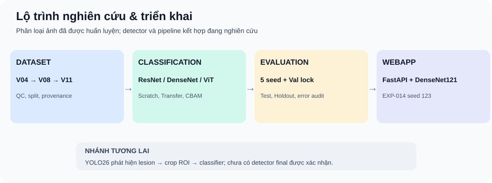
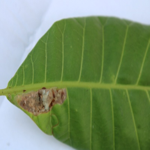
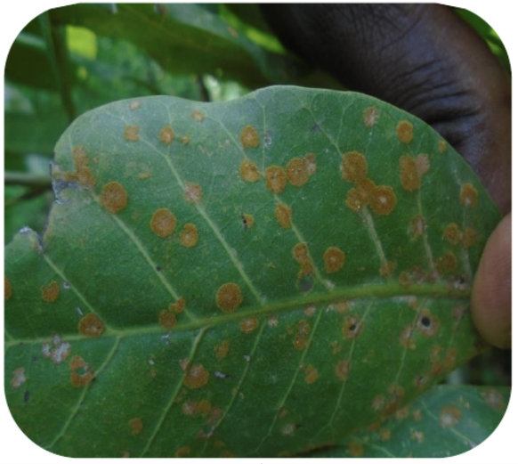

# Application — AI Cashew Leaf Diagnosis (FastAPI)

Giao diện và API phân loại lá điều **5 lớp**.

> **Cập nhật 05/11/2026 (P0 + P1).** Engine mặc định là **EXP-034** (`MODEL_ENGINE = "exp034"`): DenseNet121 ×5 + YOLO26s + Stacker F3, bundle ở `EXP-DENSENET121-YOLO-COMBINED-TRAINING-034/pipeline_bundle` (đã kiểm SHA-256). Phần mô tả EXP-014 bên dưới là engine **legacy** dự phòng.
>
> **Kiến trúc quyết định: Cổng ngoại lai → YOLO khoanh vùng → DenseNet xác minh & kết luận.**
> 0. **Cổng ngoại lai, luật cứng, 3 vùng (v2).** DenseNet ×5 chạy trên toàn ảnh và ảnh lật ngang trước khi làm bất cứ việc gì khác.
>    - **Embedding kNN:** với mỗi seed, lấy trung bình đã chuẩn hóa L2 của embedding ảnh gốc và ảnh lật.
>    - **Khoảng cách kNN:** bằng 1 − cosine trung bình trên 5 seed, tính tới ảnh gần thứ k = 5 trong bộ tham chiếu 3.721 lá điều train.
>    - Ảnh bị từ chối, và YOLO **không** được chạy, khi có một trong ba điều kiện:
>      - argmax = `not_cashew_leaf`;
>      - kNN > **0,2106** (phân vị 99,9% của lá điều Validation);
>      - kNN nằm trong **(0,1860; 0,2106]** (phân vị 99% đến 99,9%) **và** DenseNet không chắc là lá điều, tức P(không phải lá điều) ≥ 1% hoặc lớp lá điều cao nhất < 90%. Ảnh trong vùng này mà đủ điều kiện thì được nhận, kèm nhãn "qua cổng có điều kiện".
>    - Energy chỉ để tham khảo, vì đã chặn nhầm 39% ảnh lá điều chụp thực địa.
>    - Bộ tham chiếu và ngưỡng nằm trong `Application/ood/`, tạo bằng [tools/build_ood_reference.py](tools/build_ood_reference.py). Bản cổng cũ (1 seed, ngưỡng 0,197) được giữ trong các file `ood_v1_seed42_*` để quay về khi cần.
>
> | Đo cổng v2 | v1 (1 seed, 0,197) | **v2** |
> |---|---|---|
> | Giữ lá điều Val | 99,0% | **99,8%** |
> | Giữ lá điều Test / Thán thư Test | 99,4% / 98,4% | **99,6% / 99,2%** |
> | Chặn lá ngô: cháy lá / gỉ sắt / đốm xám / khỏe | 100 / 98,7 / 98,7 / 100% | **100 / 99,3 / 98,7 / 100%** |
> | Chặn `not_cashew_leaf` Val / Test | 100% / 100% | 100% / 100% |
> | 13 ảnh mẫu bị chặn | 1 (`ath_01`) | **0** |
>
> Hai ngưỡng chỉ lấy từ Validation. Tuy vậy, phương án (5 seed + lật ảnh + 3 vùng) được chọn sau khi so các biến thể trên cả Test và lá ngô, nên các con số Test và lá ngô hơi lạc quan. Cổng **chưa được thử với lá chuối hay lá xoài**.
> 1. DenseNet121 ×5 trên toàn lá → **kết luận cuối** (`FINAL_DECISION = "densenet"`). Stacker F3 vẫn được tính để đối chiếu; đặt `"stacker"` để dùng lại luật F3 (offline: DenseNet-only Test 96,20% / Holdout 83,33%; F3 Test 97,08% / Holdout 96,03%).
> 2. YOLO26s chỉ **đề xuất vùng** (lượt 640 + lượt chia ô).
> 3. DenseNet phân loại **vùng cắt có ngữ cảnh** quanh box: cạnh = max(3 × cạnh dài box, 128 px), cắt từ ảnh gốc; box nằm trong vùng cắt đã có thì dùng chung (tối đa 16 vùng cắt). "Lá khỏe" chiếm ưu thế → bác bỏ box. Tổng xác suất 3 bệnh < 50% → **chưa xác minh**, giữ nhãn YOLO.
> 4. Mỗi box mang **nhãn DenseNet** và được so với nhãn YOLO (khớp / khác nhãn). Bệnh thứ hai chỉ được báo khi YOLO **và** DenseNet cùng đồng ý trên ≥ 2 box (≥ 1 vùng cắt có độ tin cậy ≥ 0,7).
>
> | Quy tắc | Chi tiết |
> |---|---|
> | Nhãn & độ tin cậy | Kết luận lấy từ DenseNet toàn lá (hoặc F3 nếu chọn). Box không ghi đè kết luận; vùng tìm theo màu (legacy) hiển thị là "Vùng nghi ngờ", không có %. |
> | Từ chối kết luận | `conf < τ` (DenseNet: 0,60; F3: 0,504; legacy: 0,60) **hoặc** top1 − top2 < `ABSTAIN_MIN_MARGIN` (0,15); hoặc DenseNet toàn lá nói khỏe nhưng ≥ 2 vùng cắt xác nhận bệnh. |
> | Khoanh vùng | Lượt YOLO 640 gốc (giữ nguyên để tính đặc trưng stacker) + lượt **chia ô** 640px trên bản thu nhỏ ≤ 1280px (chỉ để hiển thị), gộp NMS, loại box ngoài **mặt nạ lá**. |
> | % thiệt hại | Hợp các box ∩ lá / diện tích lá (cận trên, vì box là hình chữ nhật). |
> | Đầu vào | Xoay theo EXIF; thu nhỏ khử răng cưa trước classifier (`CLASSIFIER_PREDOWNSCALE_MAX_SIDE`); kiểm tra chất lượng (độ phân giải, mờ, sáng/tối, tỉ lệ lá). Ảnh có cạnh < 64px bị từ chối (HTTP 400). |
> | Fallback | Không còn âm thầm dùng checkpoint SCRATCH-001 (dataset v01). Khi phải chuyển engine, lý do hiện trong `model_meta.engine_warning` và trên giao diện. |
>
> Tham số nằm trong [config.py](config.py), mục *Inference / display policy*. `BOX_CONF_PER_CLASS` và các ngưỡng chỉ được chỉnh trên **Validation**.

Engine legacy theo [config.py](config.py) là **DenseNet121 Transfer EXP-014 seed 123**.

## Thông tin model theo mã nguồn

| Thành phần | Giá trị |
|---|---|
| Model | DenseNet121 Transfer v014, seed 123 |
| Input | RGB 224 × 224, BILINEAR, float32 pixel 0–255 |
| Preprocessing | Đã đóng gói bên trong model, không chia 255 lần nữa |
| Validation seed 123 | Accuracy 97,27%, Macro F1 97,14%, Val Loss 0,0925 |
| Final Test V08 seed 123 | 653/686 = 95,19%, Macro F1 94,84% |
| Lớp | anthracnose, healthy, leaf_miner, red_rust, not_cashew_leaf |

**Binary checkpoint không có trong Git.** config.py cần ba file ở thư mục sau, trong đó label_map.json và deployment_metadata.json có trong repository nhưng **deployment_model.keras phải lấy đúng từ source package ngoài Git**:

~~~text
training_results/current_dataset/
└── EXP-DENSENET121-TRANSFER-5SEEDS-014_FULL/
    └── EXP-DENSENET121-TRANSFER-5SEEDS-014/
        └── model_package/
            ├── deployment_model.keras         # KHÔNG có trong Git
            ├── label_map.json
            └── deployment_metadata.json
~~~

Không thay checkpoint bằng tên khác nếu chưa xác nhận version, label order, input preprocess và serialization parity. Khi thiếu binary này, server có thể lỗi ngay khi import model_service.

## Cách khởi chạy không phụ thuộc đường dẫn máy cá nhân

Tại thư mục gốc repo, dùng Python và TensorFlow tương thích checkpoint; cần có **binary đã phục hồi**:

~~~bash
python -m venv .venv
# Kích hoạt môi trường ảo tùy Windows/macOS/Linux
python -m pip install -r Application/requirements.txt
cd Application
python -m uvicorn server:app --host 127.0.0.1 --port 8000
~~~

Truy cập **http://127.0.0.1:8000/**. Cài đặt trong môi trường tách biệt được khuyến nghị vì version Keras/TensorFlow có thể ảnh hưởng load model.

## API và kiểm tra đầu vào

| Route | Vai trò |
|---|---|
| GET /api/health | Kiểm tra dịch vụ |
| GET /api/model-info | Thông tin mô hình |
| GET /api/samples | Danh mục ảnh thử |
| POST /api/predict | Một ảnh upload |
| POST /api/predict-sample/{sample_name} | Dự đoán ảnh mẫu |

Theo [server.py](server.py), server cho phép JPG/JPEG, PNG, WEBP, BMP, TIFF, tối đa **25 MiB**. Giao diện có thể hạn chế định dạng chặt hơn server. Theo [model_service.py](model_service.py), danh sách xác suất được sắp **giảm dần** (xác suất lớn nhất trước).

## Hình ảnh thử nghiệm

| Anthracnose | Leaf Miner | Red Rust |
|:--:|:--:|:--:|
|  |  |  |

Kết quả chỉ hỗ trợ nhận diện từ ảnh, không thay chẩn đoán chuyên môn hoặc khuyến cáo phun thuốc tại thực địa. Nếu thay model WebApp, cần kiểm tra checkpoint SHA, preprocess, nhãn, inference parity, latency và phê duyệt theo quy tắc Validation; không dùng Test/Holdout lịch sử để chọn.

[README chính](../README.md) · [EXP-014](../training_results/current_dataset/EXP-DENSENET121-TRANSFER-5SEEDS-014/README.md) · [EXP-016 Test](../training_results/current_dataset/EXP-DENSENET121-TRANSFER-5SEEDS-016/README.md)
