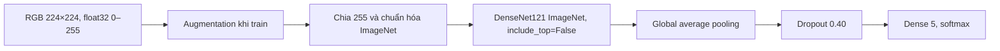

# Báo cáo mô hình DenseNet121 014 và kế hoạch đánh giá holdout 015

**Mô hình được huấn luyện:** `EXP-DENSENET121-TRANSFER-5SEEDS-014`  
**Notebook đánh giá:** `densenet121_transfer_5seed_015.ipynb`  
**Trạng thái:** 014 đã hoàn tất huấn luyện 5 seed; 015 dùng lại đúng checkpoint đã khóa bằng Validation. Kết quả real holdout của 015 **chưa chạy** tại thời điểm lập báo cáo này.

Nguồn số liệu: [014 ANALYSIS ZIP](https://drive.google.com/file/d/1Cu4uW4O6rtrID_91Mko4sV3HyuThaPek/view?usp=drive_link) và [014 FULL ZIP](https://drive.google.com/file/d/14cTqR_NX0dBnoA1njqHIS73YWgoW_LQO/view?usp=drive_link) do chủ dự án cung cấp. Đã kiểm tra CRC của ANALYSIS ZIP, SHA-256 của config, bảng Validation và manifest theo `validation_selection_lock.json`. FULL ZIP đã xác nhận metadata, nhưng chưa tải được qua connector (giới hạn 256 MB), nên hash của checkpoint sẽ được notebook 015 xác minh trực tiếp khi chạy Colab.

## 1. Kiến trúc

- **Tổng tham số:** 7.042.629 (ghi trong `training_summary_5seeds.csv` của 014).
- **Đầu vào:** RGB float32, kích thước 224 × 224, giá trị pixel 0–255; resize bilinear. Model chứa sẵn tiền xử lý `/255` và chuẩn hóa mean `[0.485, 0.456, 0.406]`, độ lệch chuẩn `[0.229, 0.224, 0.225]`. Không chuẩn hóa thêm bên ngoài model.
- **Đầu ra:** xác suất softmax theo thứ tự `anthracnose`, `healthy`, `leaf_miner`, `red_rust`, `not_cashew_leaf`.
- **Augmentation chỉ khi train:** lật ngang, rotation factor 0,08, zoom factor 0,10, contrast factor 0,10. Không dùng brightness, mixup, cutmix hay oversampling.
- **BatchNorm trong backbone:** gọi backbone với `training=False`; Stage 2 chỉ mở `conv5_*` không phải BatchNorm.

## 2. Dữ liệu và kỹ thuật huấn luyện

| Hạng mục | Cấu hình 014 |
|---|---|
| Dataset | `Cashew_dataV08_real_val`, `CashewData_Split (8).zip` |
| Train / Validation / Test | 4.790 / 1.430 / 686 ảnh; 5 lớp |
| Dataset ZIP SHA-256 | `75c5928b2f6432aca901bc16831e91f9aa4bdacc1e2ff536753d71da60c147e7` |
| Manifest SHA-256 | `1810d7e654fede9c8f6a9d08a4078be7882492db2d2d842a19b5320b9aae356b` |
| Seeds | `42`, `123`, `2026`, `3407`, `7777` |
| Batch / loss | 16 / SparseCategoricalCrossentropy |
| Optimizer | AdamW; weight decay `1e-4`; optimizer mới cho mỗi stage |
| Stage 1 | Đóng băng toàn bộ backbone, train head; LR `3e-4`; tối đa 12 epochs; EarlyStopping patience 4; ReduceLROnPlateau factor 0,5, patience 2, min LR `1e-6` |
| Stage 2 | Nạp checkpoint Stage 1 tốt nhất, mở `conv5_*` không phải BN và head; 2.129.920 tham số backbone trainable; LR `1e-5`; tối đa 30 epochs; EarlyStopping patience 8; ReduceLROnPlateau factor 0,5, patience 4, min LR `1e-7` |
| Chọn checkpoint | Loss thấp nhất trên Validation; hòa thì macro F1 cao hơn, sau đó ưu tiên Stage 1 |
| Chọn seed triển khai | Loss thấp nhất trên Validation; hòa thì macro F1 cao hơn, sau đó seed nhỏ hơn |
| Runtime train | Python 3.13.15, TensorFlow 2.21.0, Keras 3.13.2, một GPU, OneDeviceStrategy |

Validation lock được ghi lúc `2026-10-19T08:38:55.528406+00:00`; **seed triển khai 123**. Config SHA-256 `fcf1ebc509cd5c4dd54f9ad073e5af02ba5b412f72210dfee47a998c921292b2`. Không dùng Test hoặc real holdout để chọn seed, stage hay hyperparameter. `014` ghi Final Test và real holdout là `PENDING`.

## 3. Kết quả huấn luyện 014 đã ghi nhận

| Seed | Stage / epoch được chọn | Val accuracy | Val macro F1 | Val `real_` | Train Stage 1 | Train Stage 2 |
|---:|:---:|---:|---:|:---:|---:|---:|
| 42 | Stage 2 / 24 | 96,92% | 96,78% | 27/35 | 62,4 s | 188,5 s |
| 123 | Stage 2 / 29 | 97,27% | 97,14% | 28/35 | 61,8 s | 195,5 s |
| 2026 | Stage 2 / 20 | 96,85% | 96,70% | 28/35 | 61,7 s | 177,4 s |
| 3407 | Stage 2 / 24 | 97,20% | 97,05% | 28/35 | 62,2 s | 188,3 s |
| 7777 | Stage 2 / 22 | 97,27% | 97,13% | 28/35 | 61,9 s | 188,5 s |

- Validation accuracy: **97,10 ± 0,20%**; macro F1: **96,96 ± 0,21%** (mean ± sample SD, `ddof=1`, 5 seeds).
- Validation trên 35 ảnh có tên bắt đầu `real_`: **79,43 ± 1,28%**. Tiền tố file là chỉ dấu nguồn ảnh, chưa phải nhãn kiểm chứng độc lập.
- Recall Validation: anthracnose **93,83 ± 0,32%**, leaf miner **95,15 ± 0,49%**.
- False healthy trên 900 lá bệnh trong Validation/seed: **0,89 ± 0,08%**.
- Thời gian train mỗi seed: Stage 1 **62,0 ± 0,3 s**; Stage 2 **187,6 ± 6,5 s**; tổng **249,6 ± 6,6 s**. Đây là thời gian `model.fit`, không gồm audit dataset.
- Suy luận Validation, gồm đọc/resize trong pipeline: **0,623 ± 0,010 ms/ảnh**; checkpoint được chọn khoảng **44,25 MiB**.

## 4. Giao thức real holdout của 015

Notebook 015 đặt `RUN_REAL_HOLDOUT=True`, `RUN_FULL_TRAINING=False`, `RUN_FINAL_TEST=False`. Nó đọc năm checkpoint **đã train của 014**, xác minh SHA từng file theo Validation lock, dựng đúng kiến trúc/preprocessing 014 rồi mới đánh giá. Kết quả và báo cáo được lưu trong thư mục riêng `EXP-DENSENET121-TRANSFER-5SEEDS-015`; trọng số 014 không bị sửa.

Holdout gốc `RL_Cashew_holdout.zip` có 49 ảnh thuộc bốn lớp (`anthracnose` 13, `healthy` 5, `leaf_miner` 24, `red_rust` 7). Một ảnh `red_rust/IMG_3244.jpg` trùng byte với Test V08 được loại, nên **48 ảnh được chấm**. Báo cáo per-class, confusion matrix, bảng lỗi và mean ± sample SD của 5 seed chỉ xuất hiện sau khi notebook 015 thực sự chạy. Không có ảnh thật thuộc lớp `not_cashew_leaf` trong holdout.

**Giới hạn diễn giải:** holdout đã được tham khảo trong quá trình nghiên cứu, nên kết quả 015 là đối chiếu lịch sử, không phải phép thử mù mới cho khả năng tổng quát hóa thực địa. Cần một tập ảnh thực địa mới, độc lập để kết luận hiệu năng triển khai.
