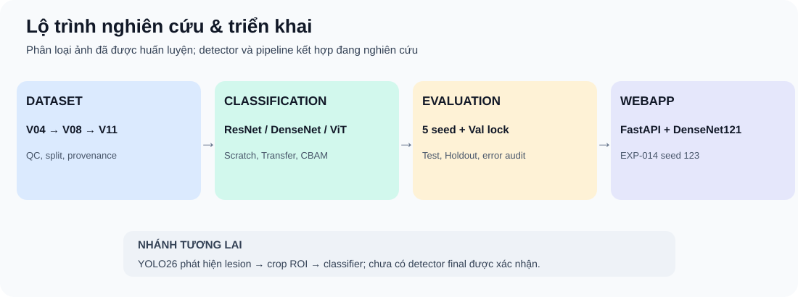
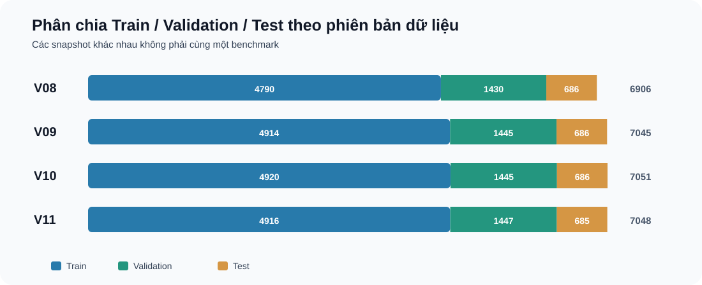
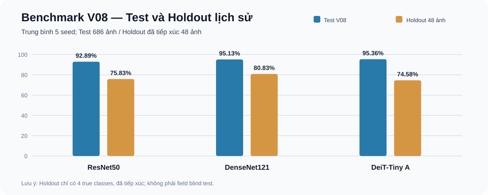
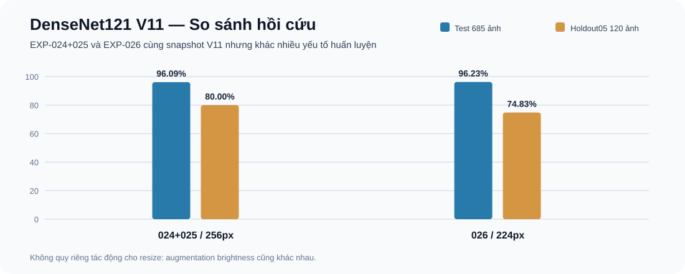
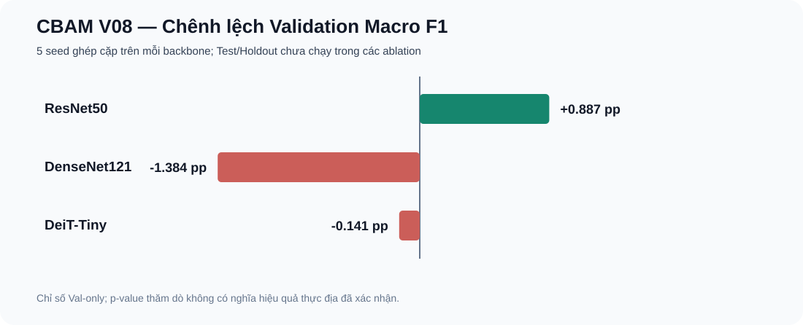
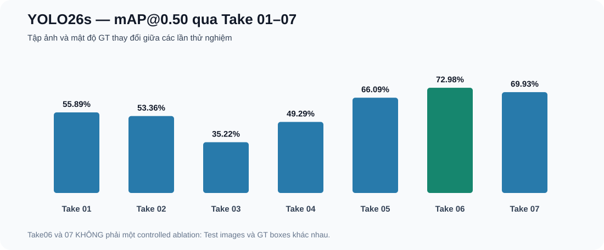
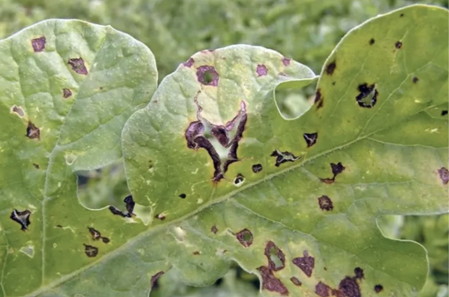
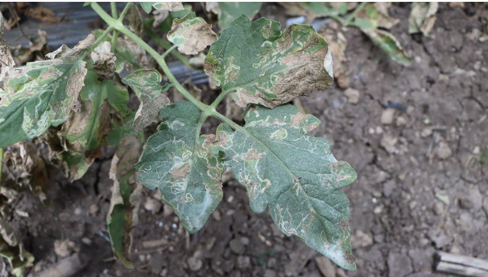
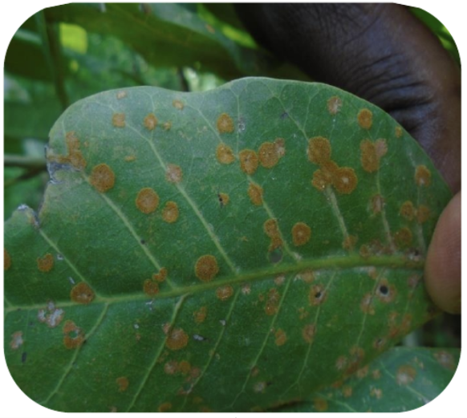

# KLTN — Hệ thống nhận diện và phân loại bệnh trên lá cây điều

> **Cập nhật: 28/10/2026 · CNTT_KLCN183.** Trang tổng hợp này đối chiếu dữ liệu, mã nguồn và báo cáo thí nghiệm theo từng phiên bản. Đặc biệt phân biệt **Validation, Test, historical Holdout và deployment**, tránh mô tả các phép đánh giá hồi cứu là kiểm thử thực địa mù.

## Tổng quan và mục tiêu

Đề tài nghiên cứu ứng dụng học sâu vào phân loại **5 lớp**: Thán thư (Anthracnose), Lá khỏe (Healthy), Sâu vẽ bùa (Leaf Miner), Rỉ đỏ (Red Rust), Không phải lá điều (Not Cashew Leaf). Các nhánh CNN và Transformer được đánh giá trên nhiều seed, kết hợp kiểm tra dữ liệu thực địa và phân tích ảnh dự đoán sai. Một nhánh khác nghiên cứu YOLO26 để phát hiện vùng bệnh và xây dựng pipeline YOLO → crop → classifier.

**Đã thực hiện:** chuẩn hóa nhiều snapshot dữ liệu, huấn luyện Scratch và Transfer, phân tích CBAM và classifier trên embeddings, đánh giá Test/Holdout, kiểm tra leakage/domain shift, xây dựng FastAPI WebApp. **Chưa hoàn tất:** blind field holdout mới đầy đủ 5 lớp, detector cuối và kiểm định pipeline kết hợp end-to-end.

| Nhánh | Hiện trạng có bằng chứng | Tài liệu |
|---|---|---|
| Dataset | V04/V05/V07/V08 → V09/V10/V11, split và ảnh/nhãn thay đổi | [Dataset changelog](DATASET_CHANGELOG.md) |
| DenseNet121 | Scratch, Transfer tới EXP-026; V11 Test/Holdout hồi cứu | [EXP-018–026](training_results/current_dataset/DENSENET121_TRANSFER_V09_V11_BACKFILL_2026_10.md) |
| ResNet50 | Scratch, ImageNet frozen, partial fine-tuning và CBAM Validation-only | [Transfer EXP-009](training_results/current_dataset/EXP-RESNET50-TRANSFER-5SEEDS-009/README.md) |
| ViT / DeiT | Scratch, DeiT-Small, DeiT-Tiny và Softmax/Logistic/XGBoost | [Classifier EXP-008/009](training_results/current_dataset/EXP-VIT-TRANSFER-XGBOOST-009/README.md) |
| Detection | YOLO26s Take 01–07, chưa có detector final | [YOLO history](failure/YOLO26/README.md) |
| WebApp | FastAPI + DenseNet121 Transfer **EXP-014, seed 123** trong config.py | [Application](Application/README.md) |

## 1. Dataset và giao thức

| Snapshot | Train | Validation | Test | Tổng |
|---|---:|---:|---:|---:|
| V08 | 4.790 | 1.430 | 686 | 6.906 |
| V09 | 4.914 | 1.445 | 686 | 7.045 |
| V10 | 4.920 | 1.445 | 686 | 7.051 |
| V11 | 4.916 | 1.447 | 685 | 7.048 |

V10 có ảnh từng thuộc Holdout được đưa vào Train; V11 thay đổi nhãn/nội dung ảnh và một phần Test so với V10. **Không gộp các dataset này vào cùng một leaderboard** như thí nghiệm chỉ thay đổi mô hình. Tiền tố real_ không xác nhận nguồn thực địa độc lập. Kiểm tra near-duplicate pHash, cùng lá/cây/phiên thu thập phải làm riêng; không suy luận 0 trùng byte tương đương không có leakage.

Seed/checkpoint phải chọn bằng **Validation**. Test dùng để đánh giá cấu hình đã khóa; nếu một Test/Holdout đã được quan sát qua nhiều vòng, phải gọi là **historical exposed/retrospective**. Holdout02–05 chỉ có 4 lớp ground truth, không đủ Not Cashew Leaf; Macro F1 4 lớp của Holdout không đồng nhất Macro F1 5 lớp của Test.

[Dataset changelog đầy đủ](DATASET_CHANGELOG.md) · [Research protocol](docs/RESEARCH_PROTOCOL.md).

## 2. Kết quả phân loại

### 2.1. Các mô hình trên V08 — 5 seed

| Nhánh | Validation Accuracy | Test Accuracy (686 ảnh) | Historical Holdout Accuracy (48 ảnh) |
|---|---:|---:|---:|
| [ResNet50 Transfer 009](training_results/current_dataset/EXP-RESNET50-TRANSFER-5SEEDS-009/README.md) | 95,23 ± 0,35% | 92,89 ± 0,51% | 75,83 ± 2,80% |
| [DenseNet121 Transfer 014/015/016](training_results/current_dataset/EXP-DENSENET121-TRANSFER-5SEEDS-016/README.md) | **97,10 ± 0,20%** | 95,13 ± 0,51% | **80,83 ± 0,93%** |
| [DeiT-Tiny Softmax A 008/009](training_results/current_dataset/EXP-VIT-TRANSFER-XGBOOST-009/README.md) | 94,41 ± 0,73% | **95,36 ± 0,49%** | 74,58 ± 6,14% |

Đây là **mean ± sample standard deviation** qua năm seed, không phải kết quả của seed được triển khai. Holdout 48 ảnh đã tiếp xúc, có 4 true classes và không phải blind test mới. DeiT-Tiny EXP-008 dùng 5 checkpoint EXP-007; EXP-009 là **inference-only**. Mặc dù Logistic Regression/XGBoost đạt Test/Holdout lịch sử cao hơn Softmax, rule đã khóa theo Validation Disease→Healthy chọn **Softmax A, seed 123**; không được đổi selection do số Test.

### 2.2. DenseNet121 V09–V11

| Experiment | Giao thức | Val Accuracy | Test Accuracy | Holdout Accuracy |
|---|---|---:|---:|---:|
| [018/019](training_results/current_dataset/EXP-DENSENET121-TRANSFER-5SEEDS-019/README.md) | Train V09 ở 018; 019 chỉ đánh giá | 96,76% | 95,13% | Holdout02 (127): 67,72% |
| [022](training_results/current_dataset/EXP-DENSENET121-TRANSFER-5SEEDS-022/README.md) | Train V10 224px | 96,72% | 94,84% | Holdout04 (120): 72,17% |
| [024/025](training_results/current_dataset/EXP-DENSENET121-TRANSFER-5SEEDS-025/README.md) | Train V11 256px + brightness; 025 chỉ đánh giá | **97,26%** | 96,09% | Holdout05 (120): **80,00%** |
| [026](training_results/current_dataset/EXP-DENSENET121-TRANSFER-5SEEDS-026/README.md) | Train mới V11 224px không brightness | 97,00% | **96,23%** | Holdout05 (120): 74,83% |

024+025 và 026 khác nhau **cả resize lẫn brightness**, vì vậy không thể khẳng định chênh lệch do riêng kích thước ảnh. Test/Holdout đã được dùng qua quá trình nghiên cứu và có tính chất hồi cứu. EXP-020/021 chỉ là các vòng đánh giá lại checkpoint EXP-018 khi Holdout thay đổi, không phải cải thiện do retrain. [Bảng nguồn và hạn chế](training_results/current_dataset/DENSENET121_TRANSFER_V09_V11_BACKFILL_2026_10.md).

### 2.3. CBAM Validation-only

Cùng 5 seed ghép cặp trên V08, thêm CBAM làm ResNet50 **+0,887 điểm phần trăm** Validation Macro F1, DenseNet121 **−1,384 điểm** và DeiT-Tiny **−0,141 điểm**. **Không có Test/Holdout** cho các ablation này; không được kết luận CBAM tự động cải thiện triển khai. [Báo cáo CBAM, CI và thăm dò thống kê](training_results/current_dataset/CBAM_ABLATION_3MODELS_V08/README.md).

## 3. YOLO26 và hướng phát hiện tổn thương

Đã thực nghiệm Take 01–07. Take 006 có Precision **0,7473**, Recall **0,6648**, mAP@0.50 **0,7298**, mAP@0.50:0.95 **0,3877**; Take 007 mAP50 **0,6993** với Test/GT thay đổi, nên hai take **không phải controlled ablation**. Chưa chốt detector cuối. Pipeline YOLO → crop ROI → classifier là **hướng phát triển**, không phải hệ thống end-to-end đã kiểm nghiệm. [Quy định gán nhãn](CASHEW_BOUNDING_BOX_ANNOTATION_GUIDELINE.md) · [Thí nghiệm detection](failure/YOLO26/README.md).

## 4. Ứng dụng Web

| Anthracnose | Leaf Miner | Red Rust |
|:--:|:--:|:--:|
|  |  |  |

Mã ứng dụng tại [Application](Application/README.md) gồm FastAPI và HTML/CSS/JavaScript. **config.py hiện tham chiếu DenseNet121 Transfer EXP-014 seed 123**, đầu vào RGB 224×224. Checkpoint binary **deployment_model.keras không được commit trong Git**; một bản clone mới không thể infer nếu chưa khôi phục đúng checkpoint từ source ngoài Git. Không tự đổi sang EXP-024/026 chỉ dựa vào Test/Holdout lịch sử.

## 5. Cấu trúc và khả năng tái lập

~~~text
.
├── README.md                       # Tổng quan và kết quả chính
├── docs/                           # Chỉ mục, protocol, biểu đồ, ghi chú
├── Application/                    # FastAPI và giao diện
├── Notebook/                       # DenseNet121, ResNet50, ViT, YOLO26
├── scripts/                        # Notebook builders và utilities
├── analysis/                       # Kiểm tra sai số và kiểm toán dữ liệu
├── training_results/
│   ├── current_dataset/           # Thực nghiệm phân loại V04–V11
│   ├── archive_legacy_dataset/    # Artifact cũ cần giữ provenance
│   └── dataset_quality_study/     # Audit ảnh thực địa
├── failure/                        # YOLO26 Take 01–07 chưa final
├── img_check/                      # Ảnh xem xét thủ công
└── DATASET_CHANGELOG.md
~~~

**Điều hướng:** [Tất cả experiment](docs/EXPERIMENT_INDEX.md) · [Training Results](training_results/README.md) · [Notebook](Notebook/README.md) · [Scripts](scripts/README.md) · [Docs](docs/README.md) · [Báo cáo kiểm kê](docs/REPOSITORY_AUDIT_2026-10-28.md).

**Giới hạn:** Một số EXP mới chỉ backfill README/CSV từ source ANALYSIS ZIP, **không chứa checkpoint, notebook chạy hoặc toàn bộ predictions/figures trong Git**. SD giữa seed không thay thế confidence về các vườn khác; đã có near-duplicate candidates và domain shift. Một fresh blind field holdout đủ 5 lớp vẫn cần thực hiện. Các checkpoint legacy lớn được giữ để tránh mất bằng chứng lịch sử.

**Tiếp theo:** kiểm tra nhóm ảnh cùng lá/cây/phiên; thu thập holdout mới độc lập; phân tích nhầm Anthracnose→Healthy; thống nhất inference contract và benchmarking tốc độ; kiểm thử YOLO crop → classifier trên tập ảnh được khóa.

## Phân tích Targeted Augmentation ResNet50 — EXP-028/029/030

Đã đưa lên GitHub hồ sơ **ResNet50 Transfer EXP-025→030** và **DINOv2-Small Transfer EXP-013**, gồm README, CSV 5 seed và checksum của ANALYSIS ZIP gốc. **Hạn chế:** đây là dữ liệu biên soạn và đối chiếu, không phải bản sao của toàn bộ ZIP, checkpoint hay các PNG gốc.

- Trên 7 ảnh real_healthy Validation: EXP-028 **42,86%** → EXP-029 **60,00%** → EXP-030 **77,14%**.
- Real Holdout 05 Healthy Recall: EXP-028 **29,23%** → EXP-030 **40,00%**, nhưng số ảnh bệnh bị gán Healthy tăng **2,0 → 6,2 ảnh/seed** và Holdout Accuracy giảm **72,50% → 71,33%**.
- EXP-029 **không** chạy Test/Holdout; Test/Holdout V11 đã được xem trong quá trình nghiên cứu, không dùng để lựa chọn tiếp hyperparameter.

**Xem:** [Báo cáo Targeted Augmentation](training_results/current_dataset/TARGETED_AUGMENTATION_RESNET50_EXP028_029_030_REPORT.md) · [Bảng 35 seed-exp](training_results/current_dataset/RECENT_V11_MODELS_5SEEDS.csv) · [Danh mục EXP](docs/EXPERIMENT_INDEX.md) · [Provenance ZIP](training_results/current_dataset/RECENT_SOURCE_ARCHIVE_PROVENANCE.csv).
