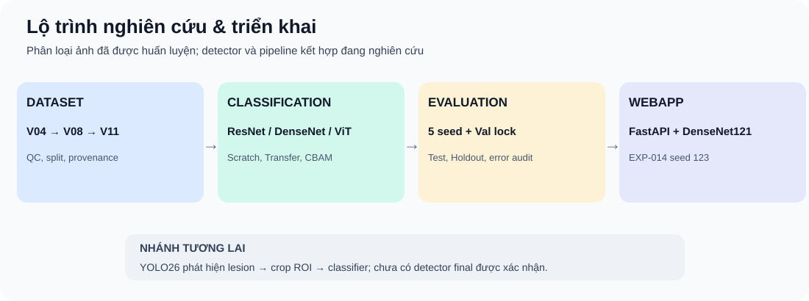

# Trung tâm tài liệu nghiên cứu

| Tài liệu | Mục tiêu |
|---|---|
| [Tiến độ mới nhất 04/11](RESEARCH_STATUS_2026-11-04.md) | DenseNet V12/V13, ResNet augmentation, YOLO NEG V03 |
| [Tiến độ 28/10 — lịch sử](RESEARCH_STATUS_2026-10-28.md) | Snapshot trước V12/V13 |
| [Toàn bộ experiment](EXPERIMENT_INDEX.md) | Điều hướng toàn bộ EXP, không bỏ sót ID |
| [Giao thức khoa học](RESEARCH_PROTOCOL.md) | Split, seeds, Test/Holdout, báo cáo, leakage |
| [Kiểm kê repository](REPOSITORY_AUDIT_2026-10-28.md) | Hướng tái tổ chức, binary và tài liệu |
| [Ghi chú lịch sử](research_notes/) | Các phân tích cũ được lưu có chỉ mục |
| [Dataset changelog](../DATASET_CHANGELOG.md) | Phiên bản dữ liệu V03–V11 |
| [Application](../Application/README.md) | Model được code sử dụng và hướng dẫn chạy |
| [Training Results](../training_results/README.md) | Tập kết quả, audit và archive |
