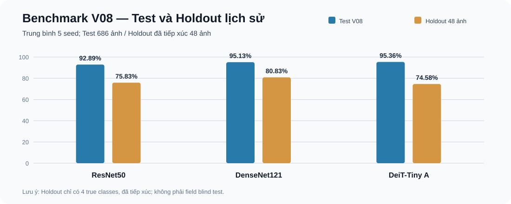
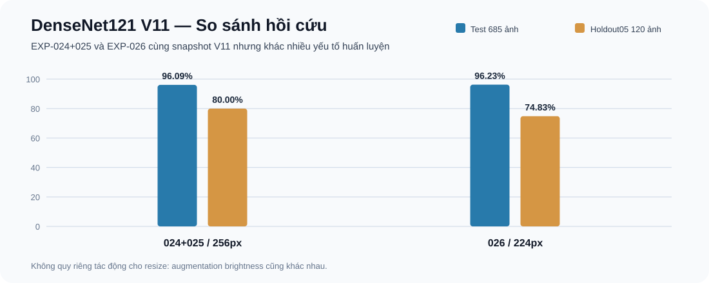

# Training Results — Kho dữ liệu thực nghiệm

## Mới nhất — 04/11/2026

- **DenseNet121 V12/V13 EXP-027/028:** Test mean 5 seed cùng **95,912%**, trên 118 Holdout trùng checksum cùng **80,17%**. [So sánh](current_dataset/DENSENET121_V12_V13_EXP027_028_COMPARISON.md).
- **ResNet50 EXP-028/029/030:** augmentation Healthy làm tăng nhầm bệnh→Healthy trên Holdout; **EXP-029 không có Test**. [Phân tích](current_dataset/TARGETED_AUGMENTATION_RESNET50_EXP028_029_030_REPORT.md).
- **YOLO NEG V03:** Validation-only, Test detection khóa. [Kết quả](yolo_negative_v03/README.md).

## YOLO NEG V03: Tăng Negative Images và đánh giá False Positive (Validation-only)

[So sánh YOLOv8s và YOLO26s NEG V03; sáu checkpoint trên cùng 951 ảnh](yolo_negative_v03/README.md). Train 3497 ảnh (621 Negative); Validation 951 (58 Negative); Test 412 giữ khóa. YOLO26s NEG V03 mAP50-95 notebook **39,81%**; False Positive Rate **3/58 (5,17%)**, YOLOv8s **13/58 (22,41%)** tại conf 0,25. Dữ liệu tóm tắt + CSV + importer; các PNG/JPG nguồn cần đồng bộ riêng.

## YOLO NEG V02: Train với Negative Images

[Phân tích YOLOv8s/YOLO26s NEG V02, False Positive và provenance 7 archive](yolo_negative_v02/README.md) — Validation-only, Test khóa. YOLO26s giảm tỷ lệ ảnh âm báo nhầm từ 15/58 còn 3/58 ở ngưỡng conf 0,25. Hiện Git chứa báo cáo và bảng tổng hợp; cần chạy đồng bộ archive nguồn để có toàn bộ hình và CSV gốc.

## YOLO class-weight ablation (Validation, 4 experiments)

[YOLOv8s và YOLO26s, cls_pw=0 so với 0.25](yolo_leaf_miner_class_weight/README.md). Bốn experiment đã được backfill các **chỉ số Validation, per-class CSV và checksum của ZIP nguồn**. Các ảnh biểu đồ, dự đoán và ZIP ANALYSIS nguyên bản chưa nằm trong Git; xem giới hạn tại trang thí nghiệm. Không dùng Test để chọn mô hình.

Mỗi thư mục thí nghiệm có **ID, dataset snapshot, config và cách đánh giá riêng**. Không gộp tất cả thành bảng xếp hạng; đặc biệt giữ ranh giới V08 với V09–V11, giữa Test và Historical Holdout.

| Khu vực | Nội dung | Xem |
|---|---|---|
| current_dataset | EXP classification Scratch/Transfer/CBAM/ViT-XGBoost, các snapshot V04–V13 | [Current dataset](current_dataset/README.md) |
| dataset_quality_study | Kiểm tra nhãn, real-prefix, ảnh trùng, domain shift | [Dataset quality](dataset_quality_study/README.md) |
| archive_legacy_dataset | Checkpoint / báo cáo gốc lịch sử | [Legacy archive](archive_legacy_dataset/README.md) |
| failure | YOLO26 Take chưa chọn final | [Detection archive](../failure/YOLO26/README.md) |

## Mốc đánh giá quan trọng
- **V08 DenseNet121 Transfer 014 + đánh giá 015/016:** 5-seed Test Accuracy **95,13 ± 0,51%**; Historical Holdout 48 ảnh **80,83 ± 0,93%**.
- **V11 DenseNet121 024+025:** Test **96,09 ± 0,42%**, Holdout05 **80,00 ± 1,56%**.
- **V11 DenseNet121 026:** Test **96,23 ± 0,56%**, Holdout05 **74,83 ± 2,24%**.
- **CBAM V08:** ba ablation mới chỉ Validation; không có Test/Holdout.

Không dùng số Test/Holdout đã tiếp xúc để chọn seed/hyperparameter. Đối với EXP chỉ backfill README/CSV từ ZIP ANALYSIS ngoài Git, không quảng bá là đã có đầy đủ checkpoint/figure/notebook. Không xóa artifact nguồn chỉ vì cũ: cấu trúc phải hỗ trợ tái lập và truy xuất lỗi.

[Danh mục toàn bộ experiment](../docs/EXPERIMENT_INDEX.md) · [Protocol](../docs/RESEARCH_PROTOCOL.md) · [Trang chính](../README.md)
