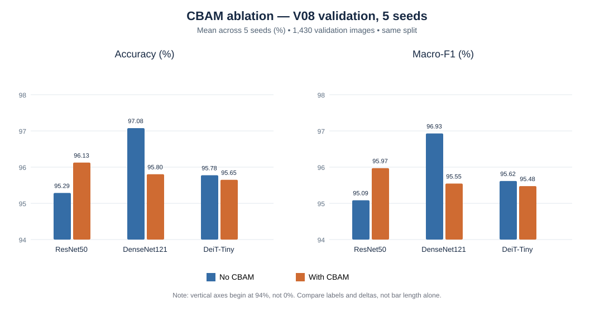

# CBAM ablation — So sánh 3 kiến trúc trên Cashew V08 (27/10/2026)

> **Trạng thái: RESEARCH ONLY — VALIDATION COMPLETE.** Test V08 (686 ảnh) và historical/field holdout **không chạy** trong ba ablation này. Không tự đổi model WebApp hay chọn lại cấu hình bằng Test.

## 1. Giao thức và nguồn

- 3 cặp đối chứng **cùng kiến trúc**: ResNet50, DenseNet121 và DeiT-Tiny; mỗi cặp có biến thể `baseline_no_cbam` và `cbam`.
- Mỗi biến thể chạy 5 seed **42, 123, 2026, 3407, 7777** trên **cùng split V08**: Train 4.790, Validation **1.430**, Test 686. Tổng 30 lượt model-seed (15 có CBAM + 15 không CBAM).
- Dataset archive SHA-256 được ghi nhất quán trong cả ba ZIP: `75c5928b2f6432aca901bc16831e91f9aa4bdacc1e2ff536753d71da60c147e7`.
- Thứ tự lớp trong các file kết quả: `anthracnose, healthy, leaf_miner, red_rust, not_cashew_leaf`; support Validation tương ứng `308, 216, 264, 328, 314`.
- Nguồn đối chứng chính là `baseline_no_cbam` **cùng ZIP**; không thay bằng các experiment lịch sử như DenseNet121-014, ResNet50-008/009 hoặc ViT-007.
- Giá trị tổng hợp lấy từ `aggregate/per_class_validation.csv` (25 hàng/biến thể); Accuracy tính bằng tổng Recall×Support / 1430, Macro-F1 là trung bình F1 của 5 lớp. Mean ± **sample SD (ddof=1)** qua 5 seed.
- So sánh có ghép cặp theo seed; CI 95% từ phân phối t với 4 bậc tự do. p-value là paired t-test hai phía **thăm dò, chưa hiệu chỉnh multiple comparisons**; 5 seed không đồng nghĩa 5 tập dữ liệu độc lập.

## 2. Kết quả Accuracy và Macro-F1

| Model | Baseline Val Acc (mean ± SD) | +CBAM Val Acc (mean ± SD) | Δ Acc (điểm %) | 95% CI Δ Acc | Baseline Macro-F1 | +CBAM Macro-F1 | Δ F1 (điểm %) |
|---|---:|---:|---:|---:|---:|---:|---:|
| **ResNet50** | 95.287 ± 0.235% | 96.126 ± 0.407% | **0.839** | [0.273; 1.405] | 95.085% | 95.972% | **0.887** |
| **DenseNet121** | 97.077 ± 0.115% | 95.804 ± 0.487% | **-1.273** | [-1.806; -0.740] | 96.930% | 95.547% | **-1.384** |
| **DeiT-Tiny** | 95.776 ± 0.319% | 95.650 ± 0.406% | **-0.126** | [-0.367; 0.115] | 95.617% | 95.476% | **-0.141** |

### Kiểm định ghép cặp (không hiệu chỉnh nhiều phép thử)

| Model | p (Δ Accuracy) | 95% CI Δ Macro-F1 (điểm %) | p (Δ Macro-F1) | Số seed CBAM tăng Accuracy |
|---|---:|---:|---:|---:|
| ResNet50 | 0.0147 | [0.297; 1.477] | 0.0140 | 5/5 |
| DenseNet121 | 0.0027 | [-1.958; -0.809] | 0.0026 | 0/5 |
| DeiT-Tiny | 0.2205 | [-0.365; 0.083] | 0.1560 | 1/5 |

**Diễn giải:** ResNet50 +CBAM tăng Val Accuracy **+0,839 điểm %** và Macro-F1 **+0,887 điểm %** (5/5 seed cải thiện, CI Δ Accuracy không chứa 0). DenseNet121 +CBAM giảm **−1,273** và **−1,384 điểm %** (5/5 seed suy giảm); còn DeiT-Tiny giảm nhẹ **−0,126** và **−0,141 điểm %** với CI Δ Accuracy chứa 0. Không suy rộng những p-value này sang dữ liệu thực địa.

## 3. F1-score theo từng lớp (%)

| Model | Class | Baseline | +CBAM | Δ (điểm %) |
|---|---|---:|---:|---:|
| ResNet50 | `anthracnose` | 90.96 | 92.39 | 1.43 |
| ResNet50 | `healthy` | 94.21 | 95.24 | 1.03 |
| ResNet50 | `leaf_miner` | 92.33 | 94.09 | 1.76 |
| ResNet50 | `red_rust` | 98.50 | 98.78 | 0.27 |
| ResNet50 | `not_cashew_leaf` | 99.42 | 99.36 | -0.06 |
| DenseNet121 | `anthracnose` | 94.33 | 91.85 | -2.47 |
| DenseNet121 | `healthy` | 96.37 | 93.41 | -2.96 |
| DenseNet121 | `leaf_miner` | 94.94 | 93.89 | -1.04 |
| DenseNet121 | `red_rust` | 99.24 | 99.00 | -0.24 |
| DenseNet121 | `not_cashew_leaf` | 99.78 | 99.58 | -0.19 |
| DeiT-Tiny | `anthracnose` | 91.83 | 91.68 | -0.15 |
| DeiT-Tiny | `healthy` | 94.40 | 93.78 | -0.62 |
| DeiT-Tiny | `leaf_miner` | 94.64 | 94.93 | 0.29 |
| DeiT-Tiny | `red_rust` | 99.06 | 98.97 | -0.09 |
| DeiT-Tiny | `not_cashew_leaf` | 98.15 | 98.02 | -0.13 |

- **ResNet50:** F1 tăng rõ nhất ở `leaf_miner` (+1,76 điểm %), `anthracnose` (+1,43), `healthy` (+1,03). `not_cashew_leaf` giảm nhẹ khoảng −0,06 điểm %.
- **DenseNet121:** F1 giảm **cả 5 lớp**, đặc biệt `healthy` (−2,96 điểm %) và `anthracnose` (−2,48). Số ảnh bệnh bị dự đoán thành Healthy tăng từ **9,6 lên 13,8 ảnh/seed** theo CSV đánh giá.
- **DeiT-Tiny:** `leaf_miner` cải thiện khoảng +0,29 điểm % nhưng `healthy` giảm −0,62; lợi ích không đủ nâng F1 chung. Số ảnh bệnh → Healthy trung bình tăng từ **19,6 lên 20,6 ảnh/seed**.

## 4. Kết luận xếp hạng và triển khai

1. **Accuracy tuyệt đối cao nhất trong 6 cấu hình** thuộc **DenseNet121 không CBAM (97,077% Validation)**, tiếp theo ResNet50 +CBAM (96,126%). Vì vậy 'CBAM có lợi cho ResNet50' **không** tương đương 'ResNet50 +CBAM là mô hình tốt nhất'.
2. **CBAM không mặc định tốt hơn:** tác dụng có thể phụ thuộc backbone, vị trí chèn, tiền huấn luyện, trainability và tối ưu hóa. Chỉ ghi nhận liên hệ thực nghiệm, chưa xác định nguyên nhân trực tiếp.
3. **Quyết định:** giữ ResNet50 +CBAM làm hướng nghiên cứu/đối chứng; DenseNet121 không CBAM làm cấu hình mạnh nhất trong benchmark này; DeiT-Tiny +CBAM chưa cho thấy lợi ích. **Không thay WebApp** bằng các kết quả Validation này.
4. **Không chọn/tune thêm bằng Test:** chỉ chạy đánh giá độc lập sau khi khóa pipeline, checkpoint và tiêu chí lựa chọn trên Validation; lưu ý repo đã có các phép Test V08 lịch sử nên Test không phải blind benchmark toàn cục cho thử nghiệm tùy chỉnh lặp lại.

## 5. Attention diagnostics và lỗi dữ liệu

- Các ZIP có **CBAM spatial/channel attention diagnostics** nhưng **chưa có overlay heatmap xác thực lên ảnh lá gốc**; không được gọi một activation map là bằng chứng CBAM tập trung đúng lesion.
- Đối với ResNet50 và DenseNet121, bản đồ không gian được trích ở resolution thấp (quan sát dạng lưới 7×7); với DeiT-Tiny cần xác minh mapping patch tokens trước khi resize về ảnh gốc.
- Một số ảnh Anthracnose bị nhận thành Healthy với confidence cao qua nhiều kiến trúc. Cần rà soát bằng ảnh gốc và chuyên môn, **không tự đổi nhãn/xóa/chuyển split dựa trên dự đoán sai**.
- Inference latency đo theo từng environment/protocol có thể không đồng nhất; không khẳng định tốc độ mô hình A nhanh hơn B chỉ bằng cách so hai ZIP khác nhau.

## 6. Dữ liệu và tài liệu tái lập

- [CSV — 30 kết quả seed/biến thể](./validation_5seeds.csv)
- [CSV — tổng hợp mean, SD, CI, p](./summary_metrics.csv)
- [CSV — F1 per class](./per_class_f1_mean.csv)
- [Biểu đồ Accuracy / Macro-F1 (SVG)](./validation_accuracy_f1.svg)
- [ResNet50 + CBAM EXP-011](../EXP-RESNET50-CBAM-TRANSFER-5SEEDS-011/README.md)
- [DenseNet121 + CBAM EXP-017](../EXP-DENSENET121-CBAM-TRANSFER-5SEEDS-017/README.md)
- [DeiT-Tiny + CBAM EXP-012](../EXP-VIT-DEITTINY-CBAM-TRANSFER-5SEEDS-012/README.md)

### Gói nguồn người dùng cung cấp (không commit trọng số nặng lên Git)

- **ResNet50:** `EXP-RESNET50-CBAM-TRANSFER-5SEEDS-011-analy.zip`
- **DenseNet121:** `EXP-DENSENET121-CBAM-TRANSFER-5SEEDS-017-Analy.zip`
- **DeiT-Tiny:** `EXP-VIT-DEITTINY-CBAM-TRANSFER-5SEEDS-012_analy.zip`

> Chỉ commit báo cáo, bảng CSV và SVG gọn nhẹ. ZIP, checkpoint `.keras`, ảnh dự đoán/ảnh cá nhân và log lớn được giữ ngoài Git theo chính sách lưu trữ hiện tại. Dữ liệu này tổng hợp trực tiếp từ ba ZIP đã cung cấp, không phải một đợt huấn luyện mới.
