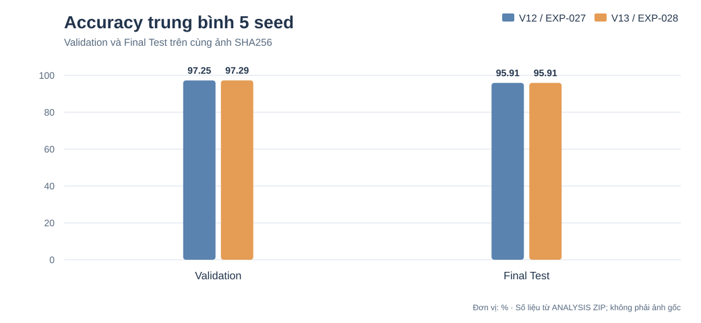
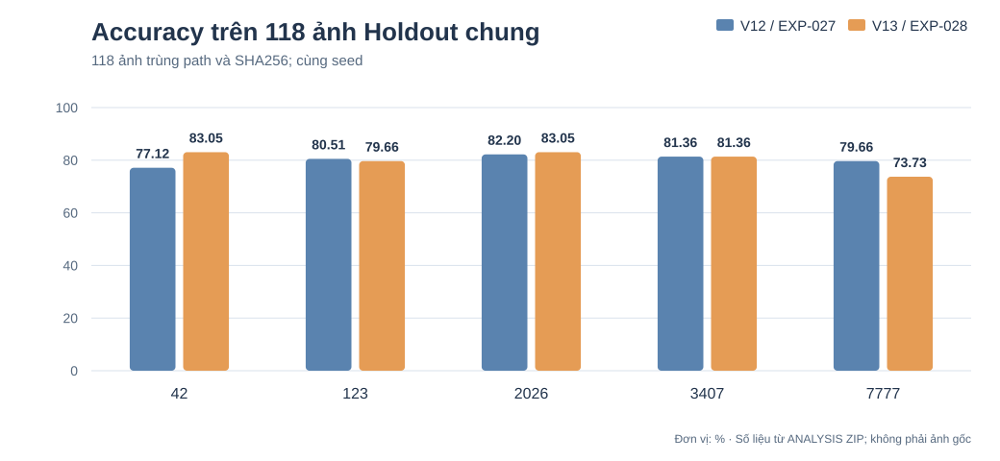
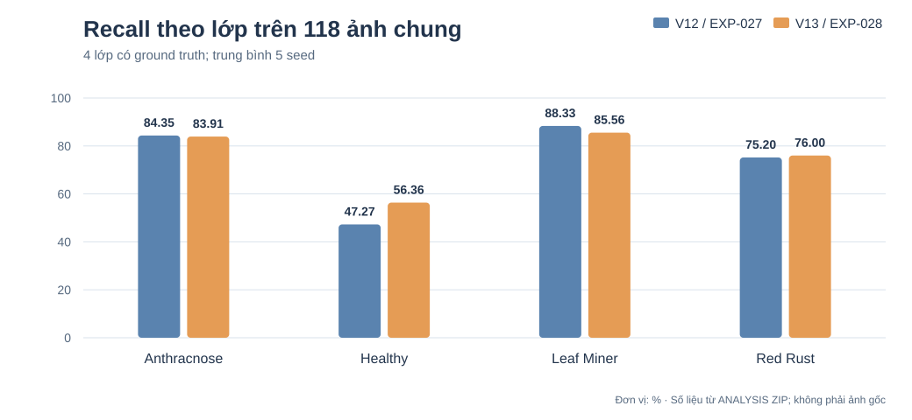
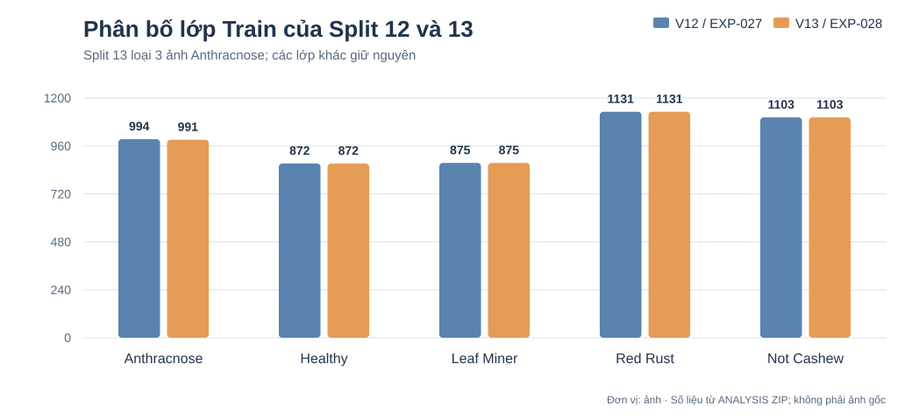

# Báo cáo DenseNet121 Transfer — EXP-027 (V12) so với EXP-028 (V13)

> **Ngày lưu hồ sơ:** 03/11/2026. Nguồn: ANALYSIS ZIP của hai lần huấn luyện, gói đánh giá riêng EXP-027/Holdout07, và bảng đối chiếu 118 ảnh trùng đường dẫn + SHA256 đã tạo từ manifest/predictions. Không huấn luyện lại; không chọn lại seed bằng Test/Holdout.

## 1. Mục tiêu và cấu hình

Đánh giá ảnh hưởng của cập nhật dữ liệu **Cashew Split (12) → Split (13)** lên DenseNet121 ImageNet pretrained. Khác biệt giữa EXP-027 và EXP-028 nằm ở dataset; kích thước 256×256, Dropout 0.4, RandomBrightness 0.08 và các hyperparameters cơ bản giữ nguyên.

| Tham số | EXP-027 | EXP-028 |
|---|---:|---:|
| Train | 4.975 | **4.972** |
| Validation | 1.452 | **1.452** (cùng byte/nội dung) |
| Final Test | 685 | **685** (cùng byte/nội dung) |
| Healthy Train | 872 | **872** |
| Anthracnose Train | 994 | **991** |
| Backbone | DenseNet121 / ImageNet | Không đổi |
| Input | 256×256 | Không đổi |
| AdamW weight decay | 1e-4 | Không đổi |
| Batch size | 16 | Không đổi |
| Stage 1 | LR 3e-4, tối đa 12 epoch | Không đổi |
| Stage 2 | LR 1e-5, tối đa 30 epoch, `conv5_*` non-BN | Không đổi |
| Seeds | 42, 123, 2026, 3407, 7777 | Không đổi |
| Checkpoint chọn bằng Validation Loss | **7777** | **42** |
| Real Holdout bản gốc | 06: 125 ảnh | 09: 126 ảnh |

Ba ảnh `real_anthracnose_155.jpg`, `157.jpg`, `159.jpg` được bỏ khỏi Train V13. Không có ảnh Healthy mới được bổ sung vào Train V13 so với V12.

## 2. Tổng hợp kết quả (mean 5 seed)

| Chỉ số | EXP-027 V12 | EXP-028 V13 | Δ điểm phần trăm |
|---|---:|---:|---:|
| Validation Accuracy | 97,245% | **97,287%** | +0,041 |
| Validation Macro F1 | 97,125% | **97,177%** | +0,052 |
| Final Test Accuracy | **95,912%** | **95,912%** | 0,000 |
| Final Test Macro F1 | 95,510% | **95,523%** | +0,013 |
| Holdout06 Accuracy (125 ảnh) | 76,320% | — | Không tương đương |
| Holdout07 Accuracy (120 ảnh; EXP027 eval-only) | 79,000% | — | Không tương đương |
| Holdout09 Accuracy (126 ảnh) | — | **79,365%** | Không tương đương |
| Holdout07 vs Holdout09 Macro F1 (4 lớp true) | 74,549% | 78,549% | +4,000; **khác dữ liệu** |

### Kết quả từng seed

| Seed | V12 Val | V13 Val | V12 Test | V13 Test | V12 Holdout06 | V13 Holdout09 |
|---:|---:|---:|---:|---:|---:|---:|
| 42 | 96,832% | 97,590% | 95,912% | 95,620% | 72,80% | **81,746%** |
| 123 | 97,245% | 97,039% | 96,058% | 95,620% | 76,00% | 78,571% |
| 2026 | 97,314% | 97,176% | 95,766% | 95,328% | 78,40% | **81,746%** |
| 3407 | 97,452% | 97,658% | 96,058% | 96,350% | 78,40% | 80,952% |
| 7777 | 97,383% | 96,970% | 95,766% | **96,642%** | 76,00% | 73,810% |

Lưu ý: không chọn seed 7777 của EXP-028 chỉ vì Test Accuracy cao hơn. Seed 42 đã được khóa qua Validation Loss (`0.078815`).

## 3. So sánh nghiêm ngặt trên 118 ảnh Holdout không thay đổi

Holdout07 có 120 ảnh, Holdout09 có 126 ảnh; trên phần giao chỉ có **118 ảnh trùng cả path và SHA256**, gồm 46 Anthracnose, 11 Healthy, 36 Leaf Miner, 25 Red Rust.

| Seed | EXP-027 đúng/118 | EXP-028 đúng/118 | Chênh lệch |
|---:|---:|---:|---:|
| 42 | 91 | **98** | +7 |
| 123 | **95** | 94 | −1 |
| 2026 | 97 | **98** | +1 |
| 3407 | 96 | 96 | 0 |
| 7777 | **94** | 87 | −7 |
| **Mean** | **80,17%** | **80,17%** | **0** |

Mức khác biệt giữa seed có hai hướng trái chiều; trung bình Accuracy **không cải thiện** trên tập ảnh giữ nguyên. Không nên dùng chênh lệch Accuracy 76,32% Holdout06 và 79,37% Holdout09 để khẳng định mô hình đã tốt hơn vì bộ ảnh đánh giá thay đổi.

### Recall theo từng lớp trên 118 ảnh chung

| Class | Support | EXP-027 | EXP-028 | Δ điểm % |
|---|---:|---:|---:|---:|
| Anthracnose | 46 | **84,35%** | 83,91% | −0,43 |
| Healthy | 11 | 47,27% | **56,36%** | +9,09 |
| Leaf Miner | 36 | **88,33%** | 85,56% | −2,78 |
| Red Rust | 25 | 75,20% | **76,00%** | +0,80 |

**Healthy có dấu hiệu tiến bộ trên cùng 11 ảnh**, nhưng vẫn không đủ để kết luận khả năng tổng quát hóa thực địa vì mẫu quá ít và có biến động giữa seed.

## 4. Giải thích khác biệt Holdout 07 và Holdout 09

- Holdout 07: 46 Anthracnose, 13 Healthy, 36 Leaf Miner, 25 Red Rust (**120 ảnh**).
- Holdout 09: 46 Anthracnose, **19 Healthy**, 36 Leaf Miner, 25 Red Rust (**126 ảnh**).
- Sáu ảnh Healthy mới trong Holdout09: `real_healthy_037`, `_038`, `_039`, `_40`, `_41`, `_42`; hai ảnh `real_healthy_029`, `_036` thay đổi nội dung.
- Trên 6 ảnh Healthy mới, EXP-028 có 22/30 lượt dự đoán đúng qua 5 seed (73,33%), nhưng **đây là 6 ảnh, không phải 30 mẫu độc lập**.
- Healthy Recall toàn Holdout09 là **61,05%** (19 ảnh, 5-seed mean), khác với 56,36% trên 11 Healthy giữ nguyên checksum.

### Vấn đề provenance nhãn cần kiểm tra

Hai cặp **ảnh trùng SHA256 nhưng đổi nhãn qua các phiên bản**:

| Train Split12 | Holdout09 | Nhãn nguồn → nhãn đánh giá |
|---|---|---|
| `train/anthracnose/real_anthracnose_157.jpg` | `healthy/real_healthy_40.jpg` | Anthracnose → Healthy |
| `train/anthracnose/real_anthracnose_159.jpg` | `healthy/real_healthy_42.jpg` | Anthracnose → Healthy |

Cả hai đã bị loại khỏi Train Split13, vì vậy **không khẳng định** có byte leakage giữa **Train V13 và Holdout09**. Tuy nhiên cần chuyên gia kiểm lại nhãn, và tuyệt đối không xem hai ảnh này là blind holdout với mô hình V12 đã từng được train trên chính byte ảnh đó.

## 5. Checkpoint triển khai theo Validation — seed 42 (EXP-028)

| Split | Accuracy seed 42 |
|---|---:|
| Validation | **97,5895%** |
| Final Test | **95,6204%** |
| Holdout09 | **103/126 = 81,746%** |

Confusion Matrix seed42 trên Holdout09 (cột Predicted: Anthracnose / Healthy / Leaf Miner / Red Rust / Not Cashew):

| Actual | Anthracnose | Healthy | Leaf Miner | Red Rust | Not Cashew |
|---|---:|---:|---:|---:|---:|
| Anthracnose (46) | 41 | 2 | 1 | 2 | 0 |
| Healthy (19) | 9 | 10 | 0 | 0 | 0 |
| Leaf Miner (36) | 2 | 0 | 34 | 0 | 0 |
| Red Rust (25) | 6 | 0 | 1 | 18 | 0 |

## 6. Độ tin cậy và giới hạn của bằng chứng

- ANALYSIS ZIP EXP-028 kiểm CRC thành công; báo cáo nguồn ghi **367/367 artifact có mặt khớp SHA256**, còn 18 checkpoint/artifact trọng số được tham chiếu nhưng không đi kèm.
- Source `pipeline_smoke.json` báo PASS; không có cặp trùng byte xuyên split được audit, nhưng còn **51 cặp nghi giống theo pHash** cần phân loại theo nhóm ảnh/cây/phiên.
- Holdout09 chỉ có 4 lớp nhãn thật, không có true `not_cashew_leaf`. Macro F1 chỉ tính 4 lớp có support; không so sánh trực tiếp với Macro F1 5 lớp của Test.
- Val/Test/Holdout lịch sử đã được dùng để phân tích các phiên bản trước. Các đối chiếu là **hồi cứu**, không dùng để tiếp tục chọn seed, kiến trúc hoặc chỉnh dataset theo dự đoán.
- Hình SVG trong repository là **biểu đồ dựng từ bảng số liệu**, không phải ảnh PNG gốc từ ZIP. PNG gốc, prediction CSV đầy đủ và checkpoint cần lấy từ archive lưu bên ngoài GitHub.

## 7. Kết luận nghiên cứu

EXP-028 là baseline DenseNet121 Transfer hợp lệ trên Split13. Validation nhích lên +0,041 điểm %, Test trung bình không đổi 95,912%; trên **118 ảnh Holdout giữ nguyên nội dung**, Accuracy không đổi 80,17% nhưng Healthy Recall tăng 9,09 điểm %. Chưa đủ bằng chứng để nâng cấp model triển khai hoặc tuyên bố V13 tổng quát hóa tốt hơn. Cần xử lý thay đổi nhãn, bổ sung blind Holdout mới đủ 5 lớp và cố định quy tắc đánh giá trước kiểm thử cuối.

## Tệp dữ liệu và kiểm toán

- [EXP-027 README](./EXP-DENSENET121-TRANSFER-5SEEDS-027/README.md) · [EXP-028 README](./EXP-DENSENET121-TRANSFER-5SEEDS-028/README.md)
- [Kết quả paired 118 ảnh/seed](./DENSENET121_V12_V13_MATCHED118_BY_SEED.csv)
- [Recall paired 118 ảnh/lớp](./DENSENET121_V12_V13_MATCHED118_PER_CLASS_RECALL.csv)
- [Holdout09 class mean](./EXP-DENSENET121-TRANSFER-5SEEDS-028/holdout09_per_class_mean.csv)
- [Confusion matrix seed 42](./EXP-DENSENET121-TRANSFER-5SEEDS-028/holdout09_seed42_confusion_matrix.csv)
- [SHA256 và danh sách ZIP nguồn](./DENSENET121_V12_V13_ARCHIVE_PROVENANCE.csv)
