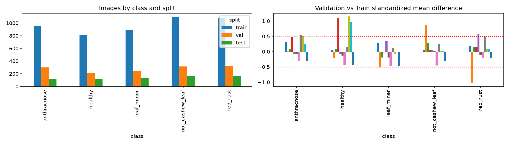
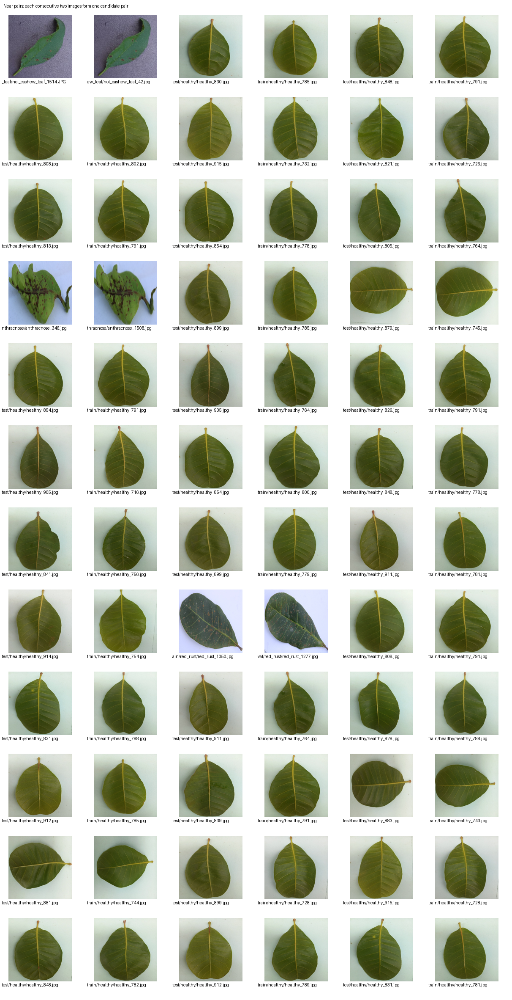

# Dataset audit — DenseNet121 EXP-001

> **Chức năng: audit dữ liệu, không phải training benchmark hay Final Test.** Hồ sơ gồm manifest, phân bố ảnh, bảng nghi trùng gần và ảnh review. Không kết luận tất cả near duplicates là leakage; phải kiểm tra thủ công cùng lá/cây/phiên.

[Kiểm tra tổng hợp](audit_summary.json) · [Danh sách near duplicates](near_duplicate_pairs.csv) · [Ảnh review ứng viên](image_review_candidates.csv) · [Exact duplicate pairs](exact_duplicate_pairs.csv) · [Dataset manifest](dataset_manifest.csv)

[Xem mọi experiment](../../../docs/EXPERIMENT_INDEX.md) · [Dataset changelog](../../../DATASET_CHANGELOG.md)
