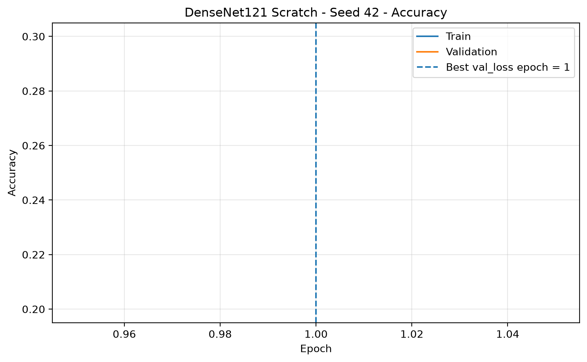
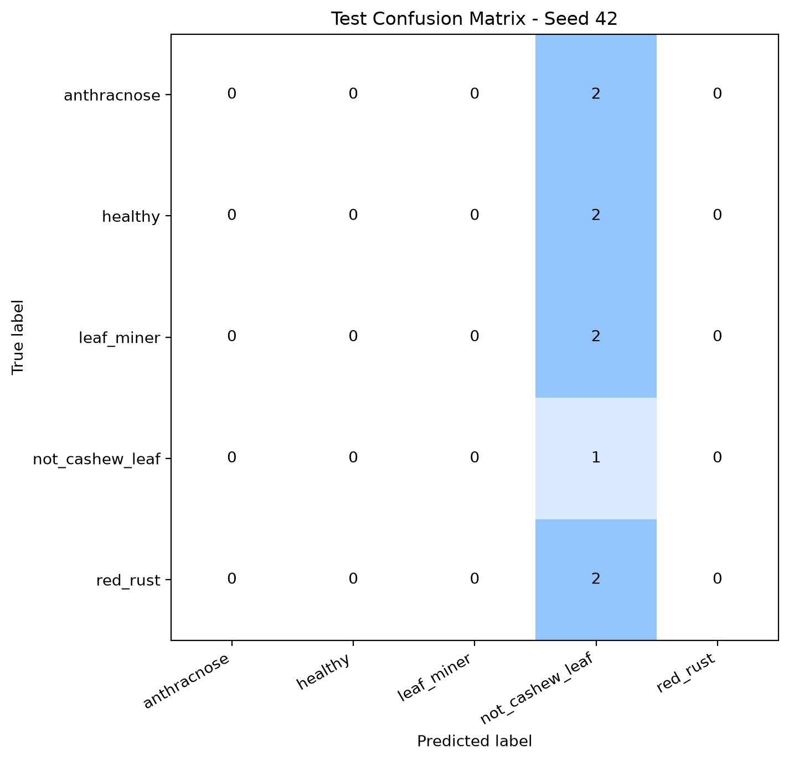

# DenseNet121 reference recipe — Smoke Test

> **SMOKE / diagnostic**, không phải benchmark final độc lập. Thư mục lưu mã nguồn recipe, một số test artifact và báo cáo smoke nhằm kiểm tra pipeline/cấu trúc file.

[Báo cáo smoke](SMOKE_REPORT.md) · [Training summary](aggregate/training_summary_5seeds.csv) · [Model builder](code/densenet121_model_builder.py) · [YOLO classifier adapter](code/yolo_classifier_adapter.py)

Các checkpoint/model cần được xác nhận hiện hữu trước khi dùng để infer. [Protocol](../../../docs/RESEARCH_PROTOCOL.md).
