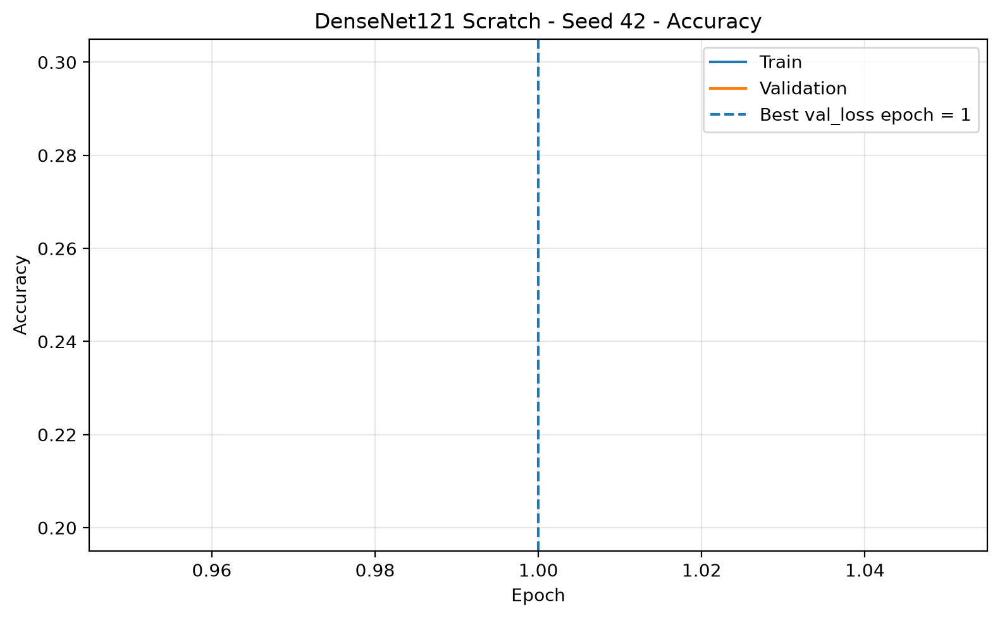
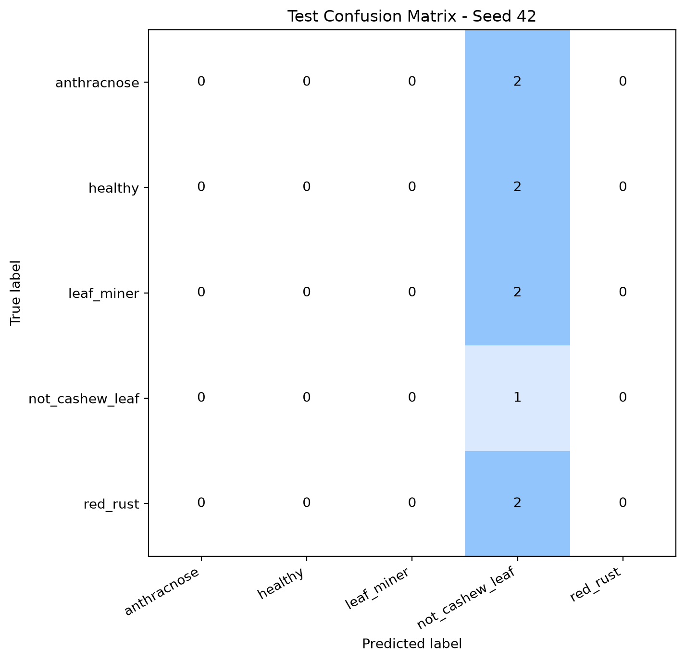

# DenseNet121 reference recipe — Smoke Test

<!-- docs-sync-2026-11-04:start -->
> **Đồng bộ README 04/11/2026:** Giữ đúng dataset, seed, config và phạm vi đánh giá gốc. Không phát sinh huấn luyện hoặc Test mới; kết quả gốc được giữ nguyên. [Trang chủ](../../../README.md) · [Danh mục 95 README](../../../docs/EXPERIMENT_INDEX.md) · [Tiến độ](../../../docs/RESEARCH_STATUS_2026-11-04.md) · [Protocol](../../../docs/RESEARCH_PROTOCOL.md).
<!-- docs-sync-2026-11-04:end -->

> **SMOKE / diagnostic**, không phải benchmark final độc lập. Thư mục lưu mã nguồn recipe, một số test artifact và báo cáo smoke nhằm kiểm tra pipeline/cấu trúc file.

[Báo cáo smoke](SMOKE_REPORT.md) · [Training summary](aggregate/training_summary_5seeds.csv) · [Model builder](code/densenet121_model_builder.py) · [YOLO classifier adapter](code/yolo_classifier_adapter.py)

Các checkpoint/model cần được xác nhận hiện hữu trước khi dùng để infer. [Protocol](../../../docs/RESEARCH_PROTOCOL.md).
