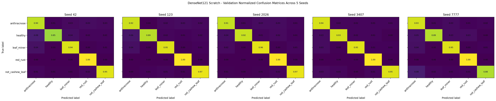

# EXP-DENSENET121-SCRATCH-5SEEDS-009

**Model:** DenseNet121 from scratch  
**Dataset:** Cashew_dataV07_clean_val  
**Seeds:** `[42, 123, 2026, 3407, 7777]`

## Dataset

| Class | Train | Val | Test | Total |
|---|---:|---:|---:|---:|
| anthracnose | 948 | 299 | 122 | 1369 |
| healthy | 806 | 213 | 118 | 1137 |
| leaf_miner | 893 | 246 | 132 | 1271 |
| red_rust | 1077 | 323 | 158 | 1558 |
| not_cashew_leaf | 1101 | 314 | 157 | 1572 |
| **TOTAL** | **4825** | **1395** | **687** | **6907** |

## Configuration

- Input: `224×224`
- Batch size: `16`
- Initial LR: `0.0001`
- ReduceLROnPlateau: factor `0.5`, patience `4`, minimum `1e-07`
- Maximum epochs: `50`
- EarlyStopping: val_loss, patience `10`
- Optimizer: Adam
- Checkpoint: minimum Validation loss
- BatchNorm momentum: Keras DenseNet121 default
- Preprocessing: DenseNet preprocess_input equivalent inside model
- Backbone call: `x = backbone(x)`

## Training curves — 5 seeds side-by-side

## Validation confusion matrices — 5 seeds side-by-side

## Validation Mean ± Std

| Metric | Result |
|---|---:|
| val_accuracy | **94.55 ± 1.11%** |
| val_macro_precision | **94.69 ± 1.01%** |
| val_macro_recall | **94.20 ± 1.18%** |
| val_macro_f1 | **94.38 ± 1.13%** |
| val_balanced_accuracy | **94.20 ± 1.18%** |

## Deployment / YOLO integration

Deployment seed selected from Validation only: **3407**.

Reusable files:
- `model_package/deployment_model.keras`
- `model_package/densenet121_feature_extractor.keras`
- `model_package/densenet121_embedding_model.keras`
- `code/yolo_classifier_adapter.py`
- `code/continue_training_example.py`

## Google Drive archive

Full ZIP destination: /content/drive/MyDrive/Cashew_Leaf_model_result/training_results/current_dataset

Archive name: `EXP-DENSENET121-SCRATCH-5SEEDS-009_FULL.zip`

## Scientific rules

- Same Train/Val/Test split for all seeds.
- Same hyperparameters for all seeds.
- Test is not used for tuning.
- Deployment seed is selected from Validation only.
- Mean ± sample standard deviation (`ddof=1`).