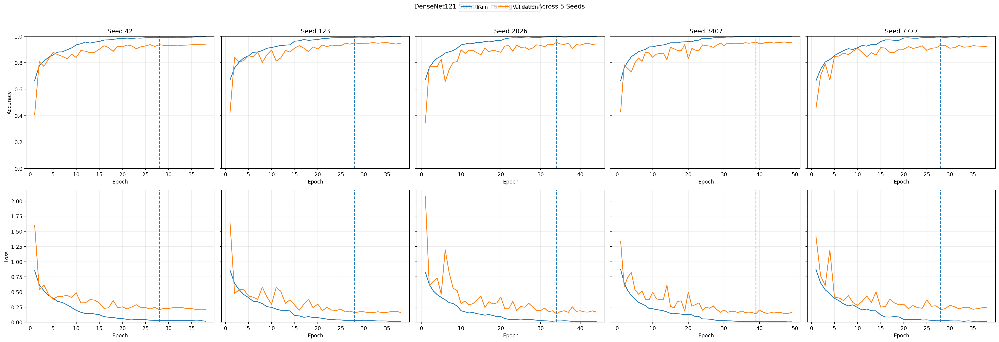

# DenseNet121 Scratch EXP-009 — artifact wrapper (historical)

<!-- docs-sync-2026-11-04:start -->
> **Đồng bộ README 04/11/2026:** Giữ đúng dataset, seed, config và phạm vi đánh giá gốc. Không phát sinh huấn luyện hoặc Test mới; kết quả gốc được giữ nguyên. [Trang chủ](../../../README.md) · [Danh mục 95 README](../../../docs/EXPERIMENT_INDEX.md) · [Tiến độ](../../../docs/RESEARCH_STATUS_2026-11-04.md) · [Protocol](../../../docs/RESEARCH_PROTOCOL.md).
<!-- docs-sync-2026-11-04:end -->

> Đây là thư mục gói **FULL** của một experiment Scratch lịch sử, không phải WebApp Transfer EXP-014. Giữ nguyên cấu trúc dưới đây để bảo toàn manifest, checksum và liên kết tới kết quả gốc.

[README gốc](EXP-DENSENET121-SCRATCH-5SEEDS-009/README.md) · [Archive format](EXP-DENSENET121-SCRATCH-5SEEDS-009/ARCHIVE_FORMAT.md) · [File manifest](EXP-DENSENET121-SCRATCH-5SEEDS-009/FILE_MANIFEST.csv) · [Checksums](EXP-DENSENET121-SCRATCH-5SEEDS-009/CHECKSUMS.sha256)

Không so trực tiếp kết quả trên snapshot cũ với V11 nếu dataset/split khác. [Danh mục](../../../docs/EXPERIMENT_INDEX.md).
