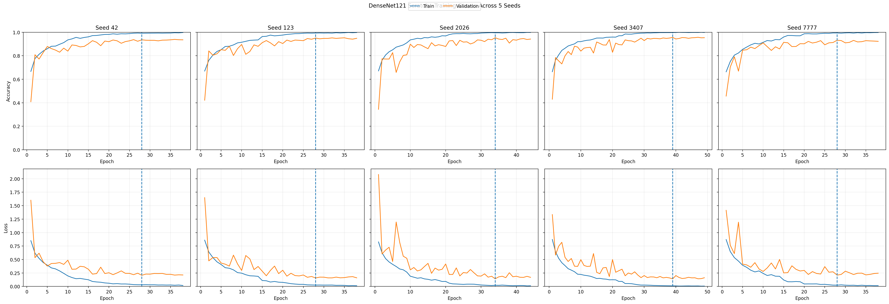

# DenseNet121 Scratch EXP-009 — artifact wrapper (historical)

> Đây là thư mục gói **FULL** của một experiment Scratch lịch sử, không phải WebApp Transfer EXP-014. Giữ nguyên cấu trúc dưới đây để bảo toàn manifest, checksum và liên kết tới kết quả gốc.

[README gốc](EXP-DENSENET121-SCRATCH-5SEEDS-009/README.md) · [Archive format](EXP-DENSENET121-SCRATCH-5SEEDS-009/ARCHIVE_FORMAT.md) · [File manifest](EXP-DENSENET121-SCRATCH-5SEEDS-009/FILE_MANIFEST.csv) · [Checksums](EXP-DENSENET121-SCRATCH-5SEEDS-009/CHECKSUMS.sha256)

Không so trực tiếp kết quả trên snapshot cũ với V11 nếu dataset/split khác. [Danh mục](../../../docs/EXPERIMENT_INDEX.md).
