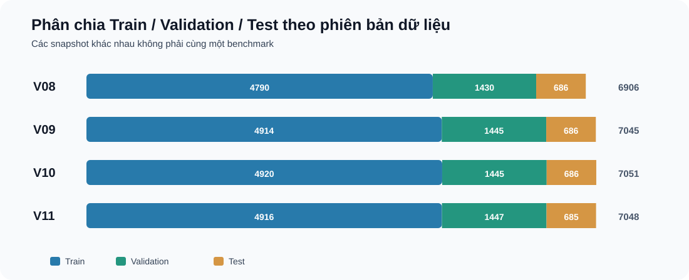
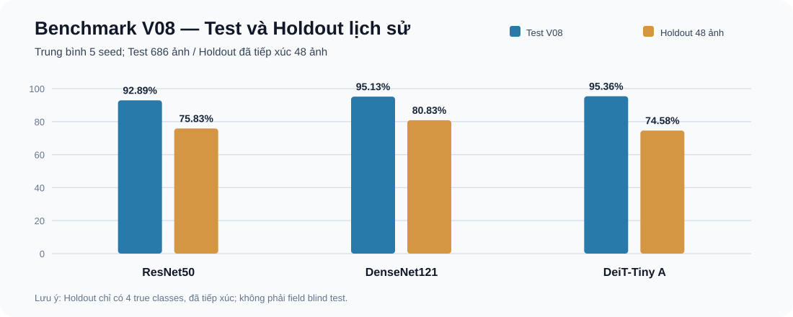
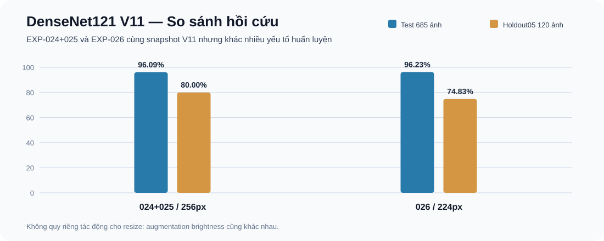
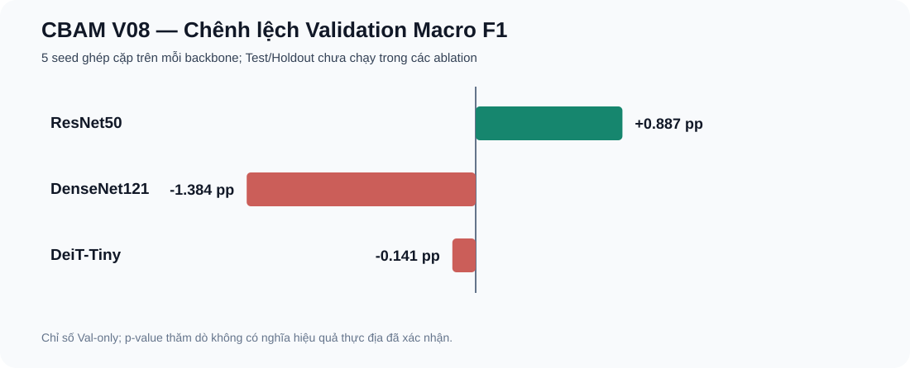

# Current Dataset — Danh mục và phân tích kết quả

## Phân biệt dataset
| Snapshot | Train | Validation | Test | Nguồn |
|---|---:|---:|---:|---|
| V04 | 4.822 | 1.402 | 687 | [benchmark_v04.csv](benchmark_v04.csv) |
| V08 | 4.790 | 1.430 | 686 | [EXP-DENSENET121-TRANSFER-014](EXP-DENSENET121-TRANSFER-5SEEDS-014/README.md) |
| V09 | 4.914 | 1.445 | 686 | [V09–V11 timeline](DENSENET121_TRANSFER_V09_V11_BACKFILL_2026_10.md) |
| V10 | 4.920 | 1.445 | 686 | [V09–V11 timeline](DENSENET121_TRANSFER_V09_V11_BACKFILL_2026_10.md) |
| V11 | 4.916 | 1.447 | 685 | [EXP-024–026](DENSENET121_TRANSFER_V09_V11_BACKFILL_2026_10.md) |
| V12 | 4.975 | 1.452 | 685 | [EXP-027](EXP-DENSENET121-TRANSFER-5SEEDS-027/README.md) |
| V13 | 4.972 | 1.452 | 685 | [EXP-028](EXP-DENSENET121-TRANSFER-5SEEDS-028/README.md) |

V05/V07 là mốc lịch sử riêng, có benchmark CSV và README tương ứng, **không giả định dùng cùng ảnh/nhãn với V04**. Đọc dataset manifest của từng experiment trước khi so sánh.

## Phân loại trên V08

| Dòng | Val Acc | Test Acc | Historical Holdout Acc |
|---|---:|---:|---:|
| [DenseNet121 Transfer 014/016](EXP-DENSENET121-TRANSFER-5SEEDS-016/README.md) | **97,10%** | 95,13% | 80,83% |
| [ResNet50 Transfer 009](EXP-RESNET50-TRANSFER-5SEEDS-009/README.md) | 95,23% | 92,89% | 75,83% |
| [ViT Softmax A / EXP-009](EXP-VIT-TRANSFER-XGBOOST-009/README.md) | 94,41% | **95,36%** | 74,58% |

Số trên là mean 5 seed. Test có 5 lớp; Holdout 48 ảnh chỉ 4 lớp, đã xem trong lịch sử. Seed WebApp DenseNet121 014 là **123**, chọn bằng Validation loss; không thay theo Test.

## DenseNet121 V09–V11

[Chi tiết EXP-018–026](DENSENET121_TRANSFER_V09_V11_BACKFILL_2026_10.md). Đặc biệt: EXP-019/020/021/025 là các lần **evaluation-only** dùng checkpoint trước đó, không phải training mới. EXP-024+025 V11 256px+brightness Test **96,09%**, Holdout05 **80,00%**; EXP-026 V11 224px không brightness Test **96,23%**, Holdout05 **74,83%**. Khác hai yếu tố nên không chứng minh resize là nguyên nhân.

## Cập nhật V12/V13 và ResNet targeted augmentation

[DenseNet121 EXP-027 vs 028](DENSENET121_V12_V13_EXP027_028_COMPARISON.md): Test Accuracy 5 seed **95,912% ở cả V12 lẫn V13**; 118 ảnh Holdout chung đúng checksum đạt **80,17% ở cả hai**. Healthy Recall trên 11 ảnh chung tăng 47,27% → 56,36%, nhưng chưa chứng minh cải thiện ngoài vườn và có xung đột nhãn giữa snapshot lịch sử.

[ResNet50 EXP-028/029/030](TARGETED_AUGMENTATION_RESNET50_EXP028_029_030_REPORT.md): real_healthy Validation Recall 42,86% → 60,00% → 77,14% trên 7 ảnh gốc, trong khi bệnh bị nhầm Healthy tăng 2,0 → 6,2 ảnh/seed ở Holdout (028 vs 030). EXP-029 không chạy Test/Holdout. **Không promote mô hình dựa trên Test/Holdout đã xem.**

## CBAM V08

[CBAM paired ablation ba backbone](CBAM_ABLATION_3MODELS_V08/README.md) có 3 kiến trúc × 2 chế độ × 5 seed; **chỉ Validation** và chưa Test/Holdout. Cần phân biệt baseline_no_cbam cùng EXP với các baseline Transfer/Scratch khác.

## Nghiên cứu có thể tái lập
[Danh mục tất cả thư mục EXP](../../docs/EXPERIMENT_INDEX.md) · [Experiment progress](EXPERIMENT_PROGRESS_2026_10.md) · [Protocol](../../docs/RESEARCH_PROTOCOL.md). Các archive backfill chỉ có thể chứa trích xuất README/CSV; không mặc nhiên có checkpoint binary, figure hoặc nguồn ZIP đầy đủ.

## ResNet50 EXP-032 và EXP-033

[Chỉ mục kết quả, notebook và SHA256 nguồn](RESNET50_032_033_ARTIFACT_INDEX.md).
