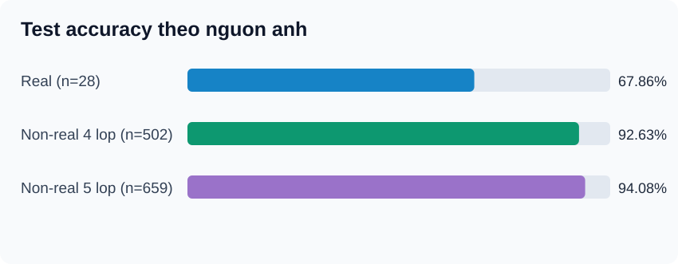
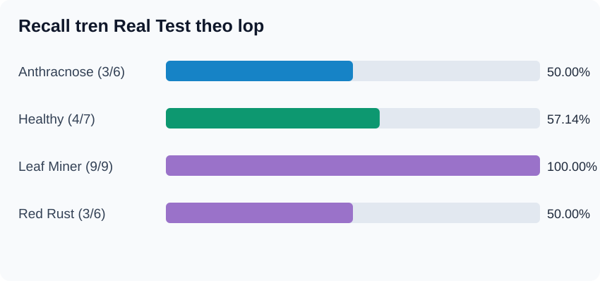

# BÁO CÁO ĐÁNH GIÁ DATASET CẢI TIẾN — IMPROVED001

> **Experiment:** `EXP-DENSENET121-SCRATCH-IMPROVED-001` · **Ngày chạy:** 13/10/2026  
> **Dataset:** `CashewData_Split (7).zip` · 5 lớp · **6.907 ảnh hợp lệ**  
> **Vai trò:** Khảo sát chất lượng dữ liệu và tổng quát hóa trên ảnh thực địa; **không thay thế benchmark chính thức Cashew_dataV05 của repo**.  
> **Bằng chứng gốc:** `EXP-DENSENET121-SCRATCH-IMPROVED-001_20261013_054209_FULL.zip`, Google Drive ID `1uMJcy84ctqsqkef4bWZra1swCScZKzBJ`.  
> **Độ tin cậy:** Tách rõ **[ĐÃ ĐO]**, **[CẢNH BÁO]** và **[GIẢ THUYẾT]**; chưa xác minh nhãn bệnh bằng chuyên gia.

## Tóm tắt nghiên cứu

Huấn luyện **DenseNet121 từ đầu** (`weights=None`, 1 seed) trên 5 lớp cho **Test Accuracy 93,01%** và **Macro F1 92,50%** (639/687 đúng). Nhưng kết quả tách theo nguồn ảnh cho thấy khoảng cách đáng chú ý: **Real Test 67,86% (19/28)** so với **Non-real Test 94,08% (620/659)**. Khi chỉ đối chiếu 4 lớp lá điều ở Non-real, Accuracy còn **92,63% (465/502)**, vẫn hơn Real **24,77 điểm phần trăm**.

Dataset cải tiến **không còn nhóm file trùng byte SHA256/xung đột nhãn trực tiếp** mà phương pháp audit phát hiện ở BASE001. Dẫu vậy vẫn còn **39 cặp nghi gần trùng pHash xuyên split**, và **Validation không có ảnh `real_`**, làm yếu khả năng chọn mô hình phù hợp với ảnh thực địa. Kết quả chưa chứng minh dataset hiện tại tốt hơn bản gốc: hai lần train có khác số lớp, số ảnh và tập Test.

## Cập nhật sau review thủ công WP2 — 13/10/2026

File Excel `near_duplicates_cross_split_review.xlsx` do người dùng gửi ghi nhận **39/39 cặp nghi gần trùng xuyên split là `Check duplicate=False`** (13 Train–Val, 20 Train–Test, 6 Val–Test). Cặp pHash distance 0 cũng được đánh dấu không trùng. **Đây là kết quả reviewer cung cấp, không phải trợ lý kiểm tra lại ảnh nguồn.**

Vì vậy 39 cảnh báo này không còn là các cặp chưa được review. Tuy nhiên, cả 39 cặp đều không chứa ảnh `real_`, và pHash không thể bảo đảm phát hiện ảnh cùng lá chụp nhiều góc. Kết luận chỉ giới hạn ở 39 cặp, **không chứng minh toàn bộ split không có data leakage**.

[Xem biên bản đầy đủ WP2](../WP2_DUPLICATE_REVIEW_RESULTS.md).

---

## Phụ lục cập nhật WP1 — Review thủ công đầy đủ 28/28 ảnh Real Test

Bản review lần hai `REAL_DATA_INVESTIGATION_WP1_001_ANALYSIS (2).zip` hoàn tất **28/28** ảnh. Reviewer chọn **22 confirmed / 6 ambiguous**; **5/6 ảnh Red Rust** ambiguous và **6/6 Red Rust** được đánh dấu `multiple_symptoms=yes`. Sau khi ghép 9 tên ảnh sai từ báo cáo IMPROVED001 (WP1 ZIP không có predictions), ảnh nền `high` chiếm **5/9** ảnh sai so với **11/19** ảnh đúng, không thể quy background cao là nguyên nhân đơn lẻ. Ở 21 ảnh có bệnh, `clear→weak` sau resize không xuất hiện trong review; vẫn chưa có đối chứng hiệu năng.

**Giới hạn:** đây là reviewer self-report, chưa có chuyên gia xác minh 6 nhãn; ROI gần như dùng tọa độ mặc định; không thay đổi Test hoặc kiến trúc dựa trên phân tích hậu nghiệm.

➡️ [Báo cáo WP1 đầy đủ 28/28](../WP1_REAL_REVIEW_COMPLETE.md).

---

## 1. Mục tiêu, câu hỏi đánh giá

1. Dataset cải tiến có giảm các vấn đề về trùng ảnh, xung đột nhãn, ảnh nghi chất lượng thấp so với Kaggle base không?
2. DenseNet121 Scratch hoạt động như thế nào trên 5 lớp và từng bệnh?
3. Khi test riêng ảnh chụp vườn `real_`, hiệu năng có suy giảm không?
4. Những yếu tố nào **có thể** gây ra lỗi và cần kiểm chứng bằng thí nghiệm độc lập?

## 2. Dữ liệu và khả năng tái lập

### 2.1. Dataset và split [ĐÃ ĐO]

Notebook **giữ nguyên** Train/Validation/Test trong ZIP, **không split lại**:

| Lớp | Train | Validation | Test | Tổng |
|---|---:|---:|---:|---:|
| `anthracnose` | 948 | 299 | 122 | 1.369 |
| `healthy` | 806 | 213 | 118 | 1.137 |
| `leaf_miner` | 893 | 246 | 132 | 1.271 |
| `red_rust` | 1.077 | 323 | 158 | 1.558 |
| `not_cashew_leaf` | 1.101 | 314 | 157 | 1.572 |
| **Tổng** | **4.825** | **1.395** | **687** | **6.907** |

Nhận diện ảnh thực địa **chỉ** theo tiền tố tên file `real_`:

| Lớp | Real Train | Real Val | Real Test |
|---|---:|---:|---:|
| `anthracnose` | 44 | 0 | 6 |
| `healthy` | 14 | 0 | 7 |
| `leaf_miner` | 89 | 0 | 9 |
| `red_rust` | 23 | 0 | 6 |
| `not_cashew_leaf` | 0 | 0 | 0 |
| **Tổng** | **170** | **0** | **28** |

- Real tổng cộng **198 ảnh**, chiếm khoảng **2,87%** dataset, và **3,52%** Train.
- **Giới hạn:** Không có `real_` không nhất thiết là dữ liệu Kaggle; tiền tố filename chỉ là proxy nguồn dữ liệu, cần xác minh manifest provenance nếu muốn kết luận về nguồn.
- **Lưu ý version:** Repo chính có `Cashew_dataV05` **6.911 ảnh (4.822 / 1.402 / 687)**, **khác** tập ZIP này **6.907 ảnh (4.825 / 1.395 / 687)**. Việc cùng 687 mẫu Test **không chứng minh Test là cùng các ảnh**. Không nhập bảng IMPROVED001 vào benchmark V05.

### 2.2. Cấu hình huấn luyện [ĐÃ ĐO]

| Thuộc tính | Giá trị |
|---|---|
| Architecture | DenseNet121 Scratch, all layers trainable |
| Pretrained weights | `None` |
| Seed | `42` (**1 seed duy nhất**) |
| Input | 224×224, DenseNet `preprocess_input` |
| Batch / Epochs | 16 / tối đa 50 |
| Optimizer / LR | Adam / 0,0001 |
| Loss | Sparse categorical crossentropy |
| Augmentation | Train only; flip ngang, rotation 0,04, zoom 0,05; không chỉnh độ sáng/contrast |
| Checkpoint selection | **Min validation loss** |
| Callbacks | Early Stopping patience=10; ReduceLROnPlateau factor=0,5, patience=4 |
| Tổng params / Trainable | 7.042.629 / 6.958.981 |
| Framework | TensorFlow 2.21.0; Keras 3.13.2 |
| Source ZIP fingerprint (SHA256) | `6983b9ab8339489f18edb00f773b319ee6c62c2a3076c199b078ef52b464a3bf` |

## 3. Kết quả định lượng

### 3.1. Toàn bộ 687 ảnh Test [ĐÃ ĐO]

| Chỉ số | Kết quả |
|---|---:|
| Test Accuracy | **93,01%** (639/687) |
| Test Loss | 0,26598 |
| Macro Precision | 92,69% |
| Macro Recall | 92,38% |
| Macro F1 | **92,50%** |
| Balanced Accuracy | **92,38%** |
| Weighted F1 | 92,95% |
| Ảnh dự đoán sai | **48/687** |
| Expected Calibration Error (ECE) | 0,0390 |
| Số epoch chạy | 49/50 |
| Best checkpoint (`val_loss`) | **Epoch 39** |
| Validation Accuracy lớn nhất | 96,13% (**epoch 49**, khác checkpoint được chọn) |
| Validation Accuracy ở best checkpoint | 95,91% |
| Train Accuracy ở best checkpoint | 99,81% |
| Thời gian huấn luyện | ≈ 18,25 phút |
| Inference time đo trong runtime | ≈ 129,77 ms/ảnh (≈ 7,71 FPS); không đại diện tốc độ web triển khai |

### 3.2. Theo từng lớp [ĐÃ ĐO]

| Lớp | Precision | Recall | F1 | Đúng/Tổng |
|---|---:|---:|---:|---:|
| `anthracnose` | 85,34% | **81,15%** | **83,19%** | 99/122 |
| `healthy` | 95,58% | 91,53% | 93,51% | 108/118 |
| `leaf_miner` | 91,04% | 92,42% | 91,73% | 122/132 |
| `red_rust` | 93,37% | 98,10% | 95,68% | 155/158 |
| `not_cashew_leaf` | 98,10% | 98,73% | 98,41% | 155/157 |

**Anthracnose là lớp yếu nhất:** 23/122 ảnh sai, trong đó `anthracnose → red_rust` **10**, `→ leaf_miner` **8**, `→ healthy` **3**, `→ not_cashew_leaf` **2**. Các lớp khác cũng thường bị nhầm về Anthracnose.

**Confusion Matrix** (hàng = nhãn gốc, cột = dự đoán):

| True ↓ / Predicted → | Anthracnose | Healthy | Leaf Miner | Red Rust | Not Cashew |
|---|---:|---:|---:|---:|---:|
| Anthracnose | **99** | 3 | 8 | 10 | 2 |
| Healthy | 6 | **108** | 4 | 0 | 0 |
| Leaf Miner | 7 | 2 | **122** | 1 | 0 |
| Red Rust | 2 | 0 | 0 | **155** | 1 |
| Not Cashew | 2 | 0 | 0 | 0 | **155** |

### 3.3. Real vs Non-real [ĐÃ ĐO]

| Nhóm Test | Đúng/Tổng | Accuracy | Macro F1 |
|---|---:|---:|---:|
| **Real, 4 lớp có nhãn `real_`** | **19/28** | **67,86%** | 67,27% |
| Non-real, 5 lớp | 620/659 | 94,08% | 93,52% |
| Non-real, **chỉ 4 lớp lá điều** | 465/502 | 92,63% | 92,33% |

- Chênh lệch cùng 4 lớp: **24,77 điểm phần trăm** Accuracy.
- Real Test chỉ **28 mẫu**; Wilson 95% CI gần đúng cho Accuracy: **49,3%–82,1%**, dưới giả định mẫu độc lập. Nếu nhiều ảnh cùng lá/cây, CI này có thể quá hẹp.
- Kết quả cho thấy sự **khác biệt thực nghiệm giữa hai nhóm**, **không** nhận diện dứt khoát cơ chế nhân quả.

**Real Test theo lớp:**

| True class | Đúng/Tổng | Recall |
|---|---:|---:|
| Anthracnose | 3/6 | **50,00%** |
| Healthy | 4/7 | **57,14%** |
| Leaf Miner | 9/9 | **100,00%** |
| Red Rust | 3/6 | **50,00%** |

Các lỗi nổi bật:
- **3 Healthy → Leaf Miner** trong nhóm Real;
- **2 Red Rust → Anthracnose** trong nhóm Real;
- **2 ảnh Real lá điều → Not Cashew Leaf** (1 Anthracnose, 1 Red Rust): rủi ro *false rejection*;
- `real_healthy_020.jpg` (Healthy → Leaf Miner) confidence **94,42%**: dự đoán sai nhưng tự tin cao.

Xem [danh sách 9 ảnh Real dự đoán sai](./REAL_TEST_ERRORS.md). Danh sách dùng cho **phân tích hậu nghiệm**, không dùng làm cơ sở tune mô hình trên Test.

## 4. Kiểm toán dữ liệu và đối chiếu BASE001

| Thuộc tính audit | BASE001 Kaggle (4 lớp) | IMPROVED001 Split7 (5 lớp) |
|---|---:|---:|
| Ảnh hợp lệ | 5.360 | **6.907** |
| Ảnh lỗi | 0 | 0 |
| **Nhóm SHA256 trùng byte** | **2** | **0** |
| **Nhóm SHA256 xung đột lớp** | **1** | **0** |
| Ảnh gắn cờ nghi mờ (heuristic) | 22 | 12 |
| Ảnh gắn cờ quá sáng (heuristic) | 1 | 16 |
| Cặp nghi gần trùng pHash (ngưỡng ≤4) | 132 | 137 |

Diễn giải đúng:
- **[ĐÃ ĐO]** Không phát hiện *exact duplicate* và *exact conflicting labels* trong ZIP cải tiến. Ở BASE001 từng có cùng file được gán hai lớp.
- **[CẢNH BÁO]** IMPROVED001 có **137 cặp pHash nghi gần trùng**, trong đó **39 cặp xuyên split**, **15 cặp khác nhãn** và **16 nhóm tương đồng xuyên split**. pHash **không** phải bằng chứng ảnh cùng lá hoặc sai nhãn.
- **[CẢNH BÁO]** Cặp ưu tiên rà soát: `train/not_cashew_leaf/not_cashew_leaf_42.jpg` ↔ `test/not_cashew_leaf/not_cashew_leaf_1514.JPG`; **pHash distance=0 nhưng SHA256 khác nhau**. Cần nhìn hai ảnh, không gọi tự động là data leakage.
- **[GIỚI HẠN]** Các thống kê ảnh nghi mờ/quá sáng dựa ngưỡng tự động, **không phải** chứng nhận bằng chuyên gia; khác phân phối lớp, nguồn và điều kiện chụp.
- **[GIỚI HẠN]** Không có `leaf_id`, `tree_id`, `session_id` đủ tin cậy để chứng minh không rò rỉ ảnh cùng đối tượng giữa các split.

## 5. Phân tích nguyên nhân theo mức độ bằng chứng

### 5.1. Thiếu ảnh Real trong Validation — **nguyên nhân thiết kế đã được xác nhận**

- **170 ảnh Real** ở Train, **0 ảnh Real** ở Validation và **28 ảnh Real** ở Test.
- Early Stopping, ReduceLR và best checkpoint đều sử dụng `val_loss`, vì vậy **không có tín hiệu Validation Real trực tiếp** cho việc chọn mô hình.
- Chỉ **14 ảnh Healthy Real Train**, 23 Red Rust, 44 Anthracnose; Leaf Miner có 89. Chênh lệch đại diện giữa các lớp rõ rệt.
- Tuy nhiên, **chưa thể khẳng định** chính thiếu Real Val gây ra chênh lệch Test: cần split lại từ **Train** hoặc dữ liệu thực địa mới để đối chứng.

### 5.2. Domain shift / khác điều kiện chụp — **giả thuyết phù hợp với quan sát**

- Ảnh Real phần lớn khoảng **3024×4032** (dọc 3:4), trong khi nhóm non-real phổ biến có kích thước **400×400**.
- Ảnh thực địa thường có nhiều lá/cành/nền đất, bóng sáng và mức độ tổn thương đa dạng; khi **resize trực tiếp về 224×224**, lá có thể bị méo tỷ lệ và lesion nhỏ bị thu hẹp.
- **Không đủ cơ sở** suy ra background hoặc resize là nguyên nhân định lượng từ một lần train; kiểm chứng bằng `resize giữ tỷ lệ + padding`, vùng lá ROI/crop, mask nền, và kiểm tra Grad-CAM trên **Validation**.

### 5.3. Nhầm lẫn Anthracnose và Red Rust — **lỗi dự đoán đã xác nhận, lý do cần chuyên gia**

- `anthracnose` Recall **81,15%**, thấp nhất; thường thành `red_rust` và `leaf_miner`.
- Có thể do hình dạng/độ màu lesion gần nhau, mức độ bệnh, nhiều bệnh trên một ảnh, nền ảnh hoặc nhiễu nhãn.
- **Không tự sửa nhãn theo dự đoán**. Cần rà ảnh gốc và xác minh chuyên môn.

### 5.4. Dấu hiệu overfitting — **dấu hiệu thực nghiệm, chưa phải nguyên nhân đơn lẻ**

- Best-val-loss epoch 39: Train Accuracy **99,81%**, Validation **95,91%** (gap **3,90 điểm phần trăm**).
- Train Loss **0,00917**, Val Loss **0,13146**; learning curves dao động.
- Kết luận: dấu hiệu học rất sát Train và chênh lệch tổng quát hóa; **không** suy ra chỉ do chất lượng ảnh hay quy mô dataset.

### 5.5. Chưa chứng nhận kiểm soát leakage — **cảnh báo yêu cầu xác minh**

- **0** SHA256 trùng xuyên split là điểm tích cực, nhưng **39** cặp pHash xuyên split vẫn cần đối chiếu.
- Ảnh cùng lá chụp ở góc khác có thể không bị SHA256/pHash phát hiện. Nên dùng group split theo leaf/tree/session nếu metadata cho phép.
- Nếu phát hiện leakage thật, **tạo một dataset version và benchmark mới**, không chỉnh âm thầm Test đã báo cáo.

## 6. Liên hệ BASE001 và giới hạn so sánh

| Chỉ tiêu mô tả | BASE001 Kaggle | IMPROVED001 Split7 |
|---|---:|---:|
| Bài toán | 4 lớp | 5 lớp, thêm Not Cashew |
| Test size | 527 | 687 |
| Accuracy | 94,50% | 93,01% |
| Macro F1 | 94,53% | 92,50% |
| Real Test được đánh giá riêng | Không | 28 ảnh |
| Số seed | 1 | 1 |

**Tuyệt đối không** diễn giải `-1,49 điểm % Accuracy` như bằng chứng bộ cải tiến kém hơn: **khác số lớp, nguồn ảnh, split và Test**. Dù mô hình/seed/hyperparameter tương tự, đây chỉ là **đối chiếu mô tả**.

**Thí nghiệm xác minh công bằng đề nghị:** hai mô hình trong **cùng bài toán 4 lớp** và đánh giá trên **cùng Real Holdout độc lập** chưa có trong Train/Val của cả hai; chức năng `not_cashew_leaf` đánh giá thành một bài toán bổ sung riêng. Không lựa chọn thay đổi dựa trên các lỗi Test đã biết.

## 7. Kế hoạch hành động có thể kiểm chứng

| Ưu tiên | Việc cần làm | Kết quả/tiêu chí |
|---|---|---|
| P0 | Khóa manifest + giữ các checkpoint và số liệu của IMPROVED001 | Có mã SHA256, config, lịch sử để tái lập |
| P0 | Review độc lập 9 lỗi Real Test, ghi `label_verified`, `symptom`, `background`, `expert_note` | Phân biệt nhãn sai / bệnh nhiều lớp / lỗi mô hình; **không tune theo Test** |
| P0 | Review 39 cặp pHash cross-split và 15 cặp khác nhãn | Phân loại `same_leaf`, `different_leaf`, `uncertain`; khi cần bổ sung session/leaf ID |
| P1 | Tạo Real Validation **từ Train hoặc ảnh mới** bằng group split | Mỗi bệnh có real-val độc lập; giữ Test hiện hành |
| P1 | Thử nghiệm preprocessing đối chứng: direct resize vs padding | Chọn theo Val/Real-Val, giữ cấu hình khác cố định |
| P1 | Thử nghiệm ROI/crop/masking và tăng đa dạng real-train | Đo Macro F1/Recall theo lớp trên Val |
| P2 | Đánh giá trên **Real Holdout độc lập chung** cho Base/Improved | Paired per-class comparison, CI; 4 lớp chung |
| P2 | Chạy ≥3–5 seeds khi đủ tài nguyên | Mean ± SD trên fixed split, không chọn seed theo Test |

> **Quy tắc tránh test leakage:** Không dùng ảnh Test đã xem lỗi để chỉnh hyperparameter, augmentation, model hoặc gán nhãn rồi chấm lại như Test độc lập. Mọi thay đổi phải được quyết định bằng Train/Validation; báo cáo thay đổi dataset version nếu buộc phải sửa dữ liệu.

## 8. Kết luận khoa học

**Đã chứng minh:** IMPROVED001 không còn duplicate SHA256/xung đột nhãn cùng file trong lần audit này; mô hình phân loại nội bộ 5 lớp tương đối tốt, nhưng **hiệu năng Real Test giảm mạnh**, Anthracnose yếu nhất, và có false rejection lá điều ngoài vườn.

**Đã phát hiện vấn đề thiết kế:** Real Validation bằng 0, tỷ lệ Real Train thấp và chênh lệch giữa các lớp; có các cặp pHash xuyên split cần kiểm chứng.

**Chưa chứng minh cơ chế nhân quả:** domain shift, background, biến dạng resize, lesion nhỏ, nhãn chưa chuẩn hoặc overfitting có thể cùng góp phần. Cần thí nghiệm có đối chứng và review thủ công.

**Chưa thể kết luận dataset đã cải tiến tốt hơn Kaggle trên ứng dụng thực tế.** Phải kiểm thử cả hai bằng cùng tập Real Holdout, cùng 4 lớp, kiểm soát nguồn gốc và bảo đảm không sử dụng Test để ra quyết định.

## 9. Dữ liệu nguồn và truy xuất

- **Source archive**: `EXP-DENSENET121-SCRATCH-IMPROVED-001_20261013_054209_FULL.zip` (lưu ngoài GitHub do có model checkpoint lớn).
- **Google Drive dataset**: [CashewData_Split (7).zip](https://drive.google.com/file/d/1uMJcy84ctqsqkef4bWZra1swCScZKzBJ/view).
- **Các file đối chiếu trong source ZIP**: `experiment_config.json`, `dataset_audit_summary.json`, `split_class_counts.csv`, `metrics/metrics.json`, `metrics/confusion_matrix.csv`, `metrics/confusion_matrix_real.csv`, `metrics/domain_results_summary.json`, `predictions/real_wrong_predictions.csv`, `near_duplicates_cross_split_review.csv`, `logs/history.csv`.
- [Bảng tóm tắt số liệu trong GitHub](./metrics_summary.csv) · [Danh sách lỗi Real](./REAL_TEST_ERRORS.md) · [Ảnh so sánh nguồn](./figures/domain_accuracy.svg) · [Recall ảnh Real](./figures/real_recall.svg).
